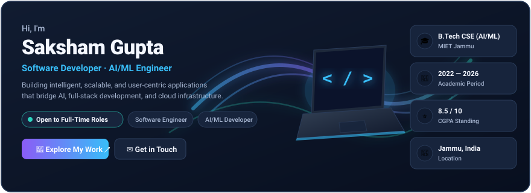
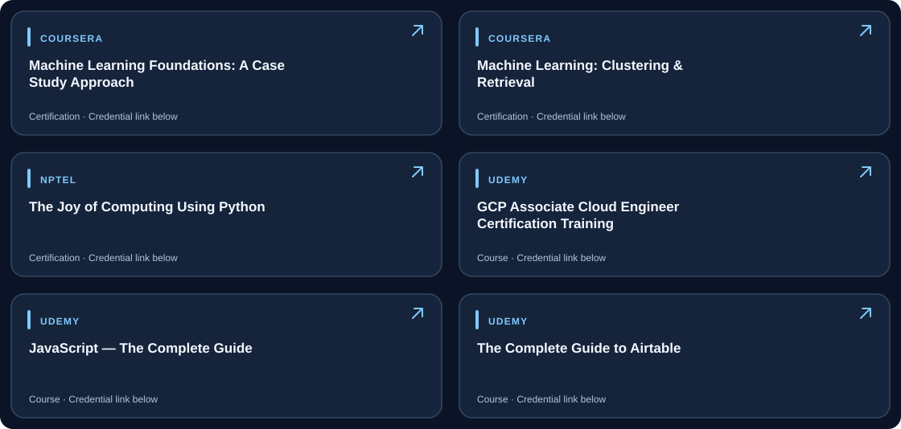

<!--
  AUTO-GENERATED FILE. DO NOT EDIT DIRECTLY.
  Source of truth: data/profile.yml
  Generated by: scripts/build_readme.py
-->

<picture>
  <source media="(prefers-color-scheme: dark)" srcset="assets/hero-dark.svg">
  <source media="(prefers-color-scheme: light)" srcset="assets/hero-light.svg">
  
</picture>

---

## 👤 About Me 

I'm **Saksham Gupta**, a Computer Science and Engineering graduate from **Model Institute of Engineering and Technology, Jammu** specializing in Artificial Intelligence and Machine Learning.

**🎯 Target Roles:** Full-Stack / Web Developer &nbsp;•&nbsp; AI/ML Engineer &nbsp;•&nbsp; Software Engineer (SDE)

---

## 💼 Professional Experience 

### Straatix Partners Labs Pvt. Ltd. 
**Software Development Engineer Intern (SDE Intern)** &nbsp;•&nbsp; 🗓️ January 2026 — July 2026 &nbsp;•&nbsp; 📍 Whitefield, Bengaluru, India

- Built and scaled React/Next.js portals for HR users and candidates, implementing dynamic interview scheduling and Supabase SSO/email authentication workflows.
- Migrated backend services to Google Cloud Platform, deploying containerized microservices on Cloud Run and integrating Vertex AI for production ML workflows.
- Engineered automated deployment pipelines with GitHub Actions and GCP Workload Identity Federation for keyless, secretless cloud delivery.

**Technologies:** <code>React</code> &nbsp;•&nbsp; <code>Next.js</code> &nbsp;•&nbsp; <code>TypeScript</code> &nbsp;•&nbsp; <code>Supabase</code> &nbsp;•&nbsp; <code>Google Cloud Platform</code> &nbsp;•&nbsp; <code>Cloud Run</code> &nbsp;•&nbsp; <code>Vertex AI</code> &nbsp;•&nbsp; <code>GitHub Actions</code> &nbsp;•&nbsp; <code>Workload Identity Federation</code>

---

### Model Institute of Engineering and Technology, Jammu 
**AI/ML Developer Intern — Director Internship** &nbsp;•&nbsp; 🗓️ February 2025 — January 2026

- Contributed to a patented evaluation engine analyzing candidate experience, Big Five personality traits, and career trajectory indicators.
- Implemented peer-group segmentation algorithms to enable fair, normalized candidate comparisons across varying backgrounds.
- Tuned and evaluated classification models to improve role-matching precision and candidate fit scoring.

**Technologies:** <code>Python</code> &nbsp;•&nbsp; <code>Scikit-learn</code> &nbsp;•&nbsp; <code>Machine Learning</code> &nbsp;•&nbsp; <code>Model Evaluation</code>

---

## ⚡ Featured Projects 

<table width="100%"><tr>
<td width="34%" valign="top"></td><td valign="top">
<h3>01 · People.ai</h3>
Applied Machine Learning<strong>Faculty Fit & Retention Prediction</strong>

  An AI-driven faculty evaluation system designed to assess role suitability and predict long-term retention using professional experience, domain expertise, and career trajectory.

<strong>What I built:</strong>

<ul>
<li>Engineered candidate profile features covering skill diversity, experience trends, and career longevity indicators.</li>
<li>Trained and evaluated supervised classification models for faculty role fit and retention prediction.</li>
</ul>

  <b>Technologies:</b> &nbsp;<code>Python</code> &nbsp;•&nbsp; <code>Scikit-learn</code> &nbsp;•&nbsp; <code>Gemini</code> &nbsp;•&nbsp; <code>Model Evaluation</code>

<b>Explore this project:</b>

<a href="https://sakshamsgupta-portfolio.vercel.app/projects/people-ai-faculty-fit">🔍 <b>Case Study ↗</b></a>

</td></tr></table>

<table width="100%"><tr>
<td width="34%" valign="top"></td><td valign="top">
<h3>02 · AI Video Interview & Emotion Analyzer</h3>
Computer Vision / Full-Stack AI<strong>Real-Time Facial Expression & Emotion Telemetry</strong>

  A web-based interview analysis platform that records video responses and processes facial expressions to generate structured emotion-analysis results.

<strong>What I built:</strong>

<ul>
<li>Developed browser video recording with MediaRecorder API and multipart streaming to Supabase Storage.</li>
<li>Built a frame-by-frame emotion telemetry pipeline using DeepFace and OpenCV Haar cascades.</li>
</ul>

  <b>Technologies:</b> &nbsp;<code>Next.js</code> &nbsp;•&nbsp; <code>Python</code> &nbsp;•&nbsp; <code>DeepFace</code> &nbsp;•&nbsp; <code>Supabase</code>

<b>Explore this project:</b>

<a href="https://sakshamsgupta-portfolio.vercel.app/projects/ai-video-interview-emotion-analyzer">🔍 <b>Case Study ↗</b></a>

</td></tr></table>

<table width="100%"><tr>
<td width="34%" valign="top"></td><td valign="top">
<h3>03 · EchoNotes</h3>
NLP / Full-Stack AI<strong>AI-Powered Transcription & Semantic Search</strong>

  An AI-powered application that converts audio and video content into structured transcripts, summaries, and searchable knowledge with timestamp-linked retrieval.

<strong>What I built:</strong>

<ul>
<li>Developed audio ingestion and transcription workflows using captions and faster-whisper.</li>
<li>Implemented semantic search using embeddings and timestamp-linked navigation.</li>
</ul>

  <b>Technologies:</b> &nbsp;<code>Next.js</code> &nbsp;•&nbsp; <code>FastAPI</code> &nbsp;•&nbsp; <code>faster-whisper</code> &nbsp;•&nbsp; <code>Supabase</code>

<b>Explore this project:</b>

<a href="https://sakshamsgupta-portfolio.vercel.app/projects/echonotes">🔍 <b>Case Study ↗</b></a> &nbsp;&nbsp;|&nbsp;&nbsp; <a href="https://youtube-video-summarizer-sage.vercel.app/">▶️ <b>Live Site ↗</b></a> &nbsp;&nbsp;|&nbsp;&nbsp; <a href="https://github.com/sakshamgupta04/Youtube-Video-Summarizer">📦 <b>Source Code ↗</b></a>

</td></tr></table>

---

## 🛠️ Technical Stack 

<picture>
  <source media="(max-width: 600px) and (prefers-color-scheme: dark)" srcset="assets/tech-stack-mobile-dark.svg">
  <source media="(max-width: 600px) and (prefers-color-scheme: light)" srcset="assets/tech-stack-mobile-light.svg">
  <source media="(max-width: 600px)" srcset="assets/tech-stack-mobile-dark.svg">
  <source media="(prefers-color-scheme: dark)" srcset="assets/tech-stack-dark.svg">
  <source media="(prefers-color-scheme: light)" srcset="assets/tech-stack-light.svg">
  
</picture>

---

## ⚡ Recent Activity 

- Merged PR #13 in `sakshamgupta04/sakshamgupta04`:  &nbsp;•&nbsp; <em>just now</em> &nbsp;•&nbsp; [View on GitHub](https://github.com/sakshamgupta04/sakshamgupta04)
- Opened PR #13 in `sakshamgupta04/sakshamgupta04`:  &nbsp;•&nbsp; <em>1m ago</em> &nbsp;•&nbsp; [View on GitHub](https://github.com/sakshamgupta04/sakshamgupta04)
- Merged PR #12 in `sakshamgupta04/sakshamgupta04`:  &nbsp;•&nbsp; <em>2m ago</em> &nbsp;•&nbsp; [View on GitHub](https://github.com/sakshamgupta04/sakshamgupta04)
- Opened PR #12 in `sakshamgupta04/sakshamgupta04`:  &nbsp;•&nbsp; <em>4m ago</em> &nbsp;•&nbsp; [View on GitHub](https://github.com/sakshamgupta04/sakshamgupta04)
- Merged PR #11 in `sakshamgupta04/sakshamgupta04`:  &nbsp;•&nbsp; <em>6m ago</em> &nbsp;•&nbsp; [View on GitHub](https://github.com/sakshamgupta04/sakshamgupta04)

---

## 📊 GitHub Metrics 

  <picture>
    <source media="(prefers-color-scheme: dark)" srcset="https://streak-stats.demolab.com/?user=sakshamgupta04&amp;theme=github-dark-blue&amp;hide_border=true&amp;timezone=Asia/Kolkata" />
    
  </picture>

### GitHub Overview

  <picture>
    <source media="(prefers-color-scheme: dark)" srcset="https://github-readme-stats.vercel.app/api?username=sakshamgupta04&amp;show_icons=true&amp;include_all_commits=true&amp;count_private=false&amp;theme=github_dark&amp;hide_border=true&amp;rank_icon=github" />
    
  </picture>

### Contribution Activity

  <picture>
    <source media="(prefers-color-scheme: dark)" srcset="https://github-readme-activity-graph.vercel.app/graph?username=sakshamgupta04&amp;theme=github-dark&amp;hide_border=true&amp;area=true" />
    
  </picture>

---

## 📖 Research Publications 

**Machine Learning-Based Approach for Diabetes Detection and Prediction**  
IEEE 3rd International Conference on Advancement in Computation & Computer Technologies (InCACCT) · 2025
[🔗 **DOI**](https://doi.org/10.1109/InCACCT65424.2025.11011335) &nbsp;&nbsp;|&nbsp;&nbsp; [📄 **Full Paper / PDF**](https://sakshamsgupta-portfolio.vercel.app/papers/diabetes-risk-forecasting.pdf)

**Evaluating the Accuracy and Computational Load of Booth's Algorithm and Vedic Multiplication in Digital Systems**  
Taylor & Francis / CRC Press · 2024
[🔗 **DOI**](https://doi.org/10.1201/9781003637530-29) &nbsp;&nbsp;|&nbsp;&nbsp; [📄 **Full Paper / PDF**](https://sakshamsgupta-portfolio.vercel.app/papers/booths-vedic-multiplication.pdf)

---

## 🎖️ Certifications &amp; Achievements 

<picture>
  <source media="(max-width: 600px) and (prefers-color-scheme: dark)" srcset="assets/certifications-mobile-dark.svg">
  <source media="(max-width: 600px) and (prefers-color-scheme: light)" srcset="assets/certifications-mobile-light.svg">
  <source media="(prefers-color-scheme: dark)" srcset="assets/certifications-dark.svg">
  <source media="(prefers-color-scheme: light)" srcset="assets/certifications-light.svg">
  
</picture>

<b>🔗 Verify all 6 credentials</b>

- **Machine Learning Foundations: A Case Study Approach** · Coursera · [View credential](https://drive.google.com/file/d/1OEpAV99YcSLHiKTEZYi837R5TxQRKD5B/view?usp=sharing)
- **Machine Learning: Clustering & Retrieval** · Coursera · [View credential](https://drive.google.com/file/d/1ltixDuXfPTm9ZjuJG0D5CUbCBdMpZNC9/view?usp=sharing)
- **The Joy of Computing Using Python** · NPTEL · [View credential](https://drive.google.com/file/d/1WuVjc5FJYyqfh6lhZQ6vbLnY26bnvM-0/view?usp=sharing)
- **GCP Associate Cloud Engineer Certification Training** · Udemy · [View credential](https://drive.google.com/file/d/1Bw5bg4Yojz2DPmFDPV0K1wRqYPpmOakV/view?usp=sharing)
- **JavaScript — The Complete Guide** · Udemy · [View credential](https://drive.google.com/file/d/17mlMA4FOzjRV_1lhhy4L5Zpctv_hgzN5/view?usp=sharing)
- **The Complete Guide to Airtable** · Udemy · [View credential](https://drive.google.com/file/d/1q7hdYtMm1DiE9gZC5GZ4lBmBxF8WlWFG/view?usp=sharing)

🏆 **Hands-on training:** AI/ML Hands-on Training Program · Model Institute of Engineering and Technology · Mar 2025

---

## 🎓 Education 

### Model Institute of Engineering and Technology, Jammu
**B.Tech in Computer Science & Engineering (AI/ML)** &nbsp;•&nbsp; 🗓️ 2022 — 2026
> **Academic Standing:** CGPA 8.5/10

---

## 🚀 Let's Connect 

I'm actively looking for software engineering, AI/ML, and full-stack development opportunities. Whether you have an open role, an engineering challenge, or want to discuss technical projects, feel free to reach out!

[🌐 **Portfolio**](https://sakshamsgupta-portfolio.vercel.app/) &nbsp;&nbsp;•&nbsp;&nbsp; [✉️ **Email**](mailto:work.saksham04@gmail.com) &nbsp;&nbsp;•&nbsp;&nbsp; [💼 **LinkedIn**](https://www.linkedin.com/in/saksham-gupta-458486294/) &nbsp;&nbsp;•&nbsp;&nbsp; [🐙 **GitHub**](https://github.com/sakshamgupta04) &nbsp;&nbsp;•&nbsp;&nbsp; [🧩 **LeetCode**](https://leetcode.com/u/wupNOxI7hc/) &nbsp;&nbsp;•&nbsp;&nbsp; [📄 **Resume**](https://sakshamsgupta-portfolio.vercel.app/Saksham_Gupta_Resume.pdf)

