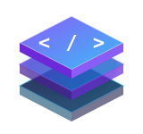
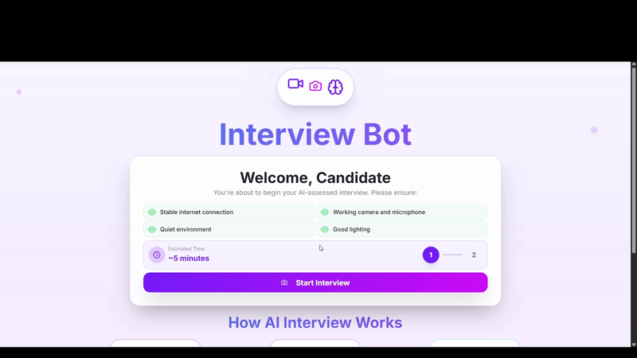
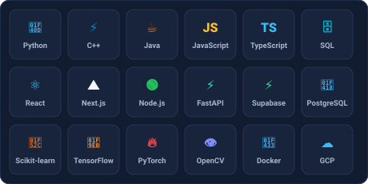

<!--
  AUTO-GENERATED FILE. DO NOT EDIT DIRECTLY.
  Source of truth: data/profile.yml
  Generated by: scripts/build_readme.py
-->

<picture>
  <source media="(prefers-color-scheme: dark)" srcset="assets/hero-dark.svg">
  <source media="(prefers-color-scheme: light)" srcset="assets/hero-light.svg">
  
</picture>

<!-- [🌐 Portfolio] --><a href="https://sakshamsgupta-portfolio.vercel.app/">🌐 <b>Portfolio Website ↗</b></a> &nbsp;&nbsp;•&nbsp;&nbsp; <!-- [🐙 GitHub] --><a href="https://github.com/sakshamgupta04">🐙 <b>GitHub ↗</b></a> &nbsp;&nbsp;•&nbsp;&nbsp; <!-- [💼 LinkedIn] --><a href="https://www.linkedin.com/in/saksham-gupta-458486294/">💼 <b>LinkedIn ↗</b></a> &nbsp;&nbsp;•&nbsp;&nbsp; <!-- [✉️ Email] --><a href="mailto:work.saksham04@gmail.com">✉️ <b>Email ↗</b></a> &nbsp;&nbsp;•&nbsp;&nbsp; <!-- [📄 Resume] --><a href="https://sakshamsgupta-portfolio.vercel.app/Saksham_Gupta_Resume.pdf">📄 <b>Resume ↓</b></a> &nbsp;&nbsp;•&nbsp;&nbsp; <!-- [🧩 LeetCode] --><a href="https://leetcode.com/u/wupNOxI7hc/">🧩 <b>LeetCode ↗</b></a>

 

**Jump to:** [About](#about) &nbsp;•&nbsp; [Experience](#experience) &nbsp;•&nbsp; [Projects](#projects) &nbsp;•&nbsp; [Tech Stack](#skills) &nbsp;•&nbsp; [Focus Areas](#expertise) &nbsp;•&nbsp; [Research](#research) &nbsp;•&nbsp; [Certifications](#certifications) &nbsp;•&nbsp; [Education](#education) &nbsp;•&nbsp; [Contact](#contact)

---

<table width="100%">
<tr>
<td width="58%" valign="top" style="border: 0; padding: 0 12px 0 0;">

<h3 style="margin-top: 0; margin-bottom: 8px;">👤 About Me </h3>

I'm <b>Saksham Gupta</b>, a Computer Science and Engineering graduate from <b>Model Institute of Engineering and Technology, Jammu</b> specializing in Artificial Intelligence and Machine Learning.

I build full-stack applications, develop AI/ML solutions, and deploy scalable systems on the cloud. I enjoy turning ideas into practical, end-to-end products that solve real-world problems with reliable engineering practices.

<b>🎯 Target Roles:</b> Full-Stack / Web Developer &nbsp;•&nbsp; AI/ML Engineer &nbsp;•&nbsp; Software Engineer (SDE)

</td>
<td width="42%" valign="top" style="border: 0; padding: 0;">

<h3 style="margin-top: 0; margin-bottom: 8px;">⚡ Quick Highlights</h3>

<table width="100%">
  <tr>
    <td width="50%" align="center" style="background-color: #17243C; border: 1px solid #293B59; border-radius: 8px; padding: 10px 4px;">
      
&lt;/&gt;

      
2+

      
Internships

    </td>
    <td width="50%" align="center" style="background-color: #17243C; border: 1px solid #293B59; border-radius: 8px; padding: 10px 4px;">
      
📦

      
3+

      
Major Projects

    </td>
  </tr>
  <tr>
    <td width="50%" align="center" style="background-color: #17243C; border: 1px solid #293B59; border-radius: 8px; padding: 10px 4px;">
      
📄

      
2

      
Research Papers

    </td>
    <td width="50%" align="center" style="background-color: #17243C; border: 1px solid #293B59; border-radius: 8px; padding: 10px 4px;">
      
🏅

      
6

      
Certifications

    </td>
  </tr>
</table>

</td>
</tr>
</table>

---

## 💼 Professional Experience 

<table width="100%">
  <tr>
    <td width="48" valign="top" align="center" style="border-right: 2px solid #8B5CF6; padding: 14px 10px;">
      

S      

    </td>
    <td valign="top" style="padding: 12px 16px;">
      <h3 style="margin-top: 0; margin-bottom: 2px;">Straatix Partners Labs Pvt. Ltd. </h3>
      

        Software Development Engineer Intern (SDE Intern)
&nbsp;&nbsp;🗓️ January 2026 — July 2026&nbsp;&nbsp;📍 Whitefield, Bengaluru, India      

      <ul style="margin: 0; padding-left: 18px; font-size: 13px; line-height: 1.55;">
        <li>Built and scaled React/Next.js portals for HR users and candidates, implementing dynamic interview scheduling and Supabase SSO/email authentication workflows.</li>
        <li>Migrated backend services to Google Cloud Platform, deploying containerized microservices on Cloud Run and integrating Vertex AI for production ML workflows.</li>
        <li>Engineered automated deployment pipelines with GitHub Actions and GCP Workload Identity Federation for keyless, secretless cloud delivery.</li>
      </ul>
      

        Tech: &nbsp;<code>React</code> &nbsp;<code>Next.js</code> &nbsp;<code>TypeScript</code> &nbsp;<code>Supabase</code> &nbsp;<code>Google Cloud Platform</code> &nbsp;<code>Cloud Run</code> &nbsp;<code>Vertex AI</code> &nbsp;<code>GitHub Actions</code> &nbsp;<code>Workload Identity Federation</code>      

    </td>
  </tr>
  <tr>
    <td width="48" valign="top" align="center" style="border-right: 2px solid #8B5CF6; padding: 14px 10px;">
      

M      

    </td>
    <td valign="top" style="padding: 12px 16px;">
      <h3 style="margin-top: 0; margin-bottom: 2px;">Model Institute of Engineering and Technology, Jammu </h3>
      

        AI/ML Developer Intern — Director Internship
&nbsp;&nbsp;🗓️ February 2025 — January 2026      

      <ul style="margin: 0; padding-left: 18px; font-size: 13px; line-height: 1.55;">
        <li>Contributed to a patented evaluation engine analyzing candidate experience, Big Five personality traits, and career trajectory indicators.</li>
        <li>Implemented peer-group segmentation algorithms to enable fair, normalized candidate comparisons across varying backgrounds.</li>
        <li>Tuned and evaluated classification models to improve role-matching precision and candidate fit scoring.</li>
      </ul>
      

        Tech: &nbsp;<code>Python</code> &nbsp;<code>Scikit-learn</code> &nbsp;<code>Machine Learning</code> &nbsp;<code>Model Evaluation</code>      

    </td>
  </tr>
</table>

---

## ⚡ Featured Projects 

<table width="100%">
  <tr>
    <td width="38%" valign="top" align="center" style="padding: 12px 14px 12px 12px;">
      
      
    </td>
    <td width="62%" valign="top" style="padding: 12px 14px 12px 0;">
      <h3 style="margin-top: 0; margin-bottom: 4px;">People.ai &nbsp;Faculty Fit & Retention Prediction</h3>
      
An AI-driven faculty evaluation system designed to assess role suitability and predict long-term retention using professional experience, domain expertise, and career trajectory.

      <b>Key Engineering Highlights:</b>
      <ul>
        <li>Engineered candidate profile features covering skill diversity, experience trends, and career longevity indicators.</li>
        <li>Trained and evaluated supervised classification models for faculty role fit and retention prediction.</li>
      </ul>
      

<code>Python</code> &nbsp;•&nbsp; <code>Scikit-learn</code> &nbsp;•&nbsp; <code>Gemini</code> &nbsp;•&nbsp; <code>Model Evaluation</code>      

      

      <a href="https://sakshamsgupta-portfolio.vercel.app/projects/people-ai-faculty-fit">🔍 <b>Case Study ↗</b></a>
      

    </td>
  </tr>
</table>

<table width="100%">
  <tr>
    <td width="38%" valign="top" align="center" style="padding: 12px 14px 12px 12px;">
      
      
    </td>
    <td width="62%" valign="top" style="padding: 12px 14px 12px 0;">
      <h3 style="margin-top: 0; margin-bottom: 4px;">AI Video Interview & Emotion Analyzer &nbsp;Real-Time Facial Expression & Emotion Telemetry</h3>
      
A web-based interview analysis platform that records video responses and processes facial expressions to generate structured emotion-analysis results.

      <b>Key Engineering Highlights:</b>
      <ul>
        <li>Developed browser video recording with MediaRecorder API and multipart streaming to Supabase Storage.</li>
        <li>Built a frame-by-frame emotion telemetry pipeline using DeepFace and OpenCV Haar cascades.</li>
      </ul>
      

<code>Next.js</code> &nbsp;•&nbsp; <code>Python</code> &nbsp;•&nbsp; <code>DeepFace</code> &nbsp;•&nbsp; <code>Supabase</code>      

      

      <a href="https://sakshamsgupta-portfolio.vercel.app/projects/ai-video-interview-emotion-analyzer">🔍 <b>Case Study ↗</b></a>
      

    </td>
  </tr>
</table>

<table width="100%">
  <tr>
    <td width="38%" valign="top" align="center" style="padding: 12px 14px 12px 12px;">
      
      
    </td>
    <td width="62%" valign="top" style="padding: 12px 14px 12px 0;">
      <h3 style="margin-top: 0; margin-bottom: 4px;">EchoNotes &nbsp;AI-Powered Transcription & Semantic Search</h3>
      
An AI-powered application that converts audio and video content into structured transcripts, summaries, and searchable knowledge with timestamp-linked retrieval.

      <b>Key Engineering Highlights:</b>
      <ul>
        <li>Developed audio ingestion and transcription workflows using captions and faster-whisper.</li>
        <li>Implemented semantic search using embeddings and timestamp-linked navigation.</li>
      </ul>
      

<code>Next.js</code> &nbsp;•&nbsp; <code>FastAPI</code> &nbsp;•&nbsp; <code>faster-whisper</code> &nbsp;•&nbsp; <code>Supabase</code>      

      

      <a href="https://sakshamsgupta-portfolio.vercel.app/projects/echonotes">🔍 <b>Case Study ↗</b></a> &nbsp;&nbsp;|&nbsp;&nbsp; <a href="https://youtube-video-summarizer-sage.vercel.app/">▶️ <b>Live Site ↗</b></a> &nbsp;&nbsp;|&nbsp;&nbsp; <a href="https://github.com/sakshamgupta04/Youtube-Video-Summarizer">📦 <b>Source Code ↗</b></a>
      

    </td>
  </tr>
</table>

---

<h3 style="margin-top: 0; margin-bottom: 8px;">🛠️ Technical Stack </h3>

<picture>
  <source media="(prefers-color-scheme: dark)" srcset="assets/tech-grid-dark.svg">
  <source media="(prefers-color-scheme: light)" srcset="assets/tech-grid-light.svg">
  
</picture>

<b>Languages:</b> <code>Python</code> &nbsp;<code>C++</code> &nbsp;<code>Java</code> &nbsp;<code>JavaScript</code> &nbsp;<code>TypeScript</code> &nbsp;<code>SQL</code>

<b>Frontend:</b> <code>React</code> &nbsp;<code>Next.js</code> &nbsp;<code>HTML</code> &nbsp;<code>CSS</code>

<b>Backend & APIs:</b> <code>Node.js</code> &nbsp;<code>REST APIs</code> &nbsp;<code>Supabase Serverless Functions</code> &nbsp;<code>FastAPI</code>

<b>Databases:</b> <code>Supabase</code> &nbsp;<code>PostgreSQL</code> &nbsp;<code>Supabase Auth</code> &nbsp;<code>Supabase Storage</code>

<b>AI/ML:</b> <code>Scikit-learn</code> &nbsp;<code>TensorFlow</code> &nbsp;<code>PyTorch</code> &nbsp;<code>OpenCV</code> &nbsp;<code>DeepFace</code> &nbsp;<code>Pandas</code> &nbsp;<code>NumPy</code>

<b>Cloud & DevOps:</b> <code>Google Cloud Platform</code> &nbsp;<code>Cloud Run</code> &nbsp;<code>Vertex AI</code> &nbsp;<code>Docker</code> &nbsp;<code>GitHub Actions</code> &nbsp;<code>Workload Identity Federation</code>

<b>Developer Tools:</b> <code>Git</code> &nbsp;<code>GitHub</code> &nbsp;<code>VS Code</code> &nbsp;<code>Jupyter Notebook</code> &nbsp;<code>Airtable</code> &nbsp;<code>Claude</code>

---

<h3 style="margin-top: 0; margin-bottom: 8px;">🎯 Core Focus Areas </h3>

<table width="100%">
  <tr>
    <td width="33%" valign="top" style="background-color: #17243C; border: 1px solid #8B5CF6; border-radius: 8px; padding: 12px 14px;">
      <h4 style="margin: 0 0 6px 0; color: #8B5CF6; font-size: 13.5px;">🧠 AI &amp; Machine Learning</h4>
      <ul style="margin: 0; padding-left: 16px; font-size: 12px; line-height: 1.6;">
        <li>Predictive Modeling</li>
        <li>Computer Vision</li>
        <li>Feature Engineering</li>
        <li>Model Evaluation</li>
      </ul>
    </td>
    <td width="33%" valign="top" style="background-color: #17243C; border: 1px solid #38BDF8; border-radius: 8px; padding: 12px 14px;">
      <h4 style="margin: 0 0 6px 0; color: #38BDF8; font-size: 13.5px;">&lt;/&gt; Full-Stack Engineering</h4>
      <ul style="margin: 0; padding-left: 16px; font-size: 12px; line-height: 1.6;">
        <li>React &amp; Next.js</li>
        <li>REST APIs &amp; FastAPI</li>
        <li>Supabase &amp; PostgreSQL</li>
        <li>Scalable Architectures</li>
      </ul>
    </td>
    <td width="33%" valign="top" style="background-color: #17243C; border: 1px solid #2DD4BF; border-radius: 8px; padding: 12px 14px;">
      <h4 style="margin: 0 0 6px 0; color: #2DD4BF; font-size: 13.5px;">☁️ Cloud &amp; Deployment</h4>
      <ul style="margin: 0; padding-left: 16px; font-size: 12px; line-height: 1.6;">
        <li>Google Cloud Platform (GCP)</li>
        <li>Cloud Run &amp; Vertex AI</li>
        <li>Docker &amp; Microservices</li>
        <li>Keyless CI/CD (GCP WIF)</li>
      </ul>
    </td>
  </tr>
</table>

---

<h3 style="margin-top: 0; margin-bottom: 8px;">📖 Research Publications </h3>

<table width="100%" style="background-color: #17243C; border: 1px solid #293B59; border-radius: 8px; margin-bottom: 10px;">
  <tr>
    <td width="72%" valign="top" style="border: 0; padding: 10px 14px;">
      <h4 style="margin: 0 0 4px 0; color: #F4F7FF; font-size: 13px;">Machine Learning-Based Approach for Diabetes Detection and Prediction</h4>
      

        <i>Saksham Gupta, Gandharv Kaloo, Palvi Sharma, Aarush Wali</i> &nbsp;•&nbsp; <b>IEEE 3rd International Conference on Advancement in Computation & Computer Technologies (InCACCT)</b> (2025)      

    </td>
    <td width="28%" valign="middle" align="center" style="border: 0; padding: 10px 8px;">
      <a href="https://doi.org/10.1109/InCACCT65424.2025.11011335" style="display: block; margin-bottom: 6px; padding: 4px 8px; background-color: #111C31; border: 1px solid #293B59; border-radius: 6px; font-size: 11px; font-weight: 600; color: #38BDF8;">🔗 <b>DOI ↗</b><!-- [🔗 **DOI**](https://doi.org/10.1109/InCACCT65424.2025.11011335) --></a>
      <a href="https://sakshamsgupta-portfolio.vercel.app/papers/diabetes-risk-forecasting.pdf" style="display: block; padding: 4px 8px; background-color: #111C31; border: 1px solid #293B59; border-radius: 6px; font-size: 11px; font-weight: 600; color: #F4F7FF;">📄 <b>PDF ↗</b><!-- [📄 **Full Paper / PDF**](https://sakshamsgupta-portfolio.vercel.app/papers/diabetes-risk-forecasting.pdf) --></a>
    </td>
  </tr>
</table>
<table width="100%" style="background-color: #17243C; border: 1px solid #293B59; border-radius: 8px; margin-bottom: 10px;">
  <tr>
    <td width="72%" valign="top" style="border: 0; padding: 10px 14px;">
      <h4 style="margin: 0 0 4px 0; color: #F4F7FF; font-size: 13px;">Evaluating the Accuracy and Computational Load of Booth's Algorithm and Vedic Multiplication in Digital Systems</h4>
      

        <i>Veena Tripathi, Saksham Gupta, Aarush Wali, Archit Bali, Aradhika Gandotra, Ayushman Vohra</i> &nbsp;•&nbsp; <b>Taylor & Francis / CRC Press</b> (2024)      

    </td>
    <td width="28%" valign="middle" align="center" style="border: 0; padding: 10px 8px;">
      <a href="https://doi.org/10.1201/9781003637530-29" style="display: block; margin-bottom: 6px; padding: 4px 8px; background-color: #111C31; border: 1px solid #293B59; border-radius: 6px; font-size: 11px; font-weight: 600; color: #38BDF8;">🔗 <b>DOI ↗</b><!-- [🔗 **DOI**](https://doi.org/10.1201/9781003637530-29) --></a>
      <a href="https://sakshamsgupta-portfolio.vercel.app/papers/booths-vedic-multiplication.pdf" style="display: block; padding: 4px 8px; background-color: #111C31; border: 1px solid #293B59; border-radius: 6px; font-size: 11px; font-weight: 600; color: #F4F7FF;">📄 <b>PDF ↗</b><!-- [📄 **Full Paper / PDF**](https://sakshamsgupta-portfolio.vercel.app/papers/booths-vedic-multiplication.pdf) --></a>
    </td>
  </tr>
</table>

---

<h3 style="margin-top: 0; margin-bottom: 8px;">🎖️ Certifications &amp; Achievements </h3>

<table width="100%">
  <tr>
    <td width="66%" valign="top" style="border: 0; padding: 0 8px 0 0;">
      <ul style="margin: 0; padding-left: 16px; font-size: 12px; line-height: 1.6;">
        <li>
          ✔ <b>Machine Learning Foundations: A Case Study Approach</b> — Coursera
          <a href="https://drive.google.com/file/d/1OEpAV99YcSLHiKTEZYi837R5TxQRKD5B/view?usp=sharing" style="color: #38BDF8; font-weight: 600;">Verify Credential ↗<!-- [Verify Credential](https://drive.google.com/file/d/1OEpAV99YcSLHiKTEZYi837R5TxQRKD5B/view?usp=sharing) --></a>
        </li>
        <li>
          ✔ <b>Machine Learning: Clustering & Retrieval</b> — Coursera
          <a href="https://drive.google.com/file/d/1ltixDuXfPTm9ZjuJG0D5CUbCBdMpZNC9/view?usp=sharing" style="color: #38BDF8; font-weight: 600;">Verify Credential ↗<!-- [Verify Credential](https://drive.google.com/file/d/1ltixDuXfPTm9ZjuJG0D5CUbCBdMpZNC9/view?usp=sharing) --></a>
        </li>
        <li>
          ✔ <b>The Joy of Computing Using Python</b> — NPTEL
          <a href="https://drive.google.com/file/d/1WuVjc5FJYyqfh6lhZQ6vbLnY26bnvM-0/view?usp=sharing" style="color: #38BDF8; font-weight: 600;">Verify Credential ↗<!-- [Verify Credential](https://drive.google.com/file/d/1WuVjc5FJYyqfh6lhZQ6vbLnY26bnvM-0/view?usp=sharing) --></a>
        </li>
        <li>
          ✔ <b>GCP Associate Cloud Engineer Certification Training</b> — Udemy
          <a href="https://drive.google.com/file/d/1Bw5bg4Yojz2DPmFDPV0K1wRqYPpmOakV/view?usp=sharing" style="color: #38BDF8; font-weight: 600;">Verify Credential ↗<!-- [Verify Credential](https://drive.google.com/file/d/1Bw5bg4Yojz2DPmFDPV0K1wRqYPpmOakV/view?usp=sharing) --></a>
        </li>
        <li>
          ✔ <b>JavaScript — The Complete Guide</b> — Udemy
          <a href="https://drive.google.com/file/d/17mlMA4FOzjRV_1lhhy4L5Zpctv_hgzN5/view?usp=sharing" style="color: #38BDF8; font-weight: 600;">Verify Credential ↗<!-- [Verify Credential](https://drive.google.com/file/d/17mlMA4FOzjRV_1lhhy4L5Zpctv_hgzN5/view?usp=sharing) --></a>
        </li>
        <li>
          ✔ <b>The Complete Guide to Airtable</b> — Udemy
          <a href="https://drive.google.com/file/d/1q7hdYtMm1DiE9gZC5GZ4lBmBxF8WlWFG/view?usp=sharing" style="color: #38BDF8; font-weight: 600;">Verify Credential ↗<!-- [Verify Credential](https://drive.google.com/file/d/1q7hdYtMm1DiE9gZC5GZ4lBmBxF8WlWFG/view?usp=sharing) --></a>
        </li>
      </ul>
    </td>
    <td width="34%" valign="middle" align="center" style="border: 1px solid #8B5CF6; background-color: #17243C; border-radius: 8px; padding: 12px 8px;">
      
🏆

      
Hands-on Training

      
AI/ML Hands-on Training Program, MIET (Mar 2025)

    </td>
  </tr>
</table>

---

<h3 style="margin-top: 0; margin-bottom: 8px;">🎓 Education </h3>

<table width="100%" style="background-color: #17243C; border: 1px solid #293B59; border-radius: 8px;">
  <tr>
    <td width="12%" align="center" valign="middle" style="border: 0; padding: 12px 6px;">
      
🏛️

    </td>
    <td width="64%" valign="middle" style="border: 0; padding: 12px 8px;">
      <h4 style="margin: 0 0 2px 0; color: #F4F7FF; font-size: 13px;">Model Institute of Engineering and Technology, Jammu</h4>
      
B.Tech in Computer Science & Engineering (AI/ML) &nbsp;|&nbsp; 🗓️ 2022 — 2026

    </td>
    <td width="24%" align="center" valign="middle" style="border: 0; padding: 12px 8px;">
      

        CGPA: 8.5/10
      

      <!-- CGPA 8.5/10 -->
    </td>
  </tr>
</table>

---

<h3 style="margin-top: 0; margin-bottom: 8px;">🚀 Let's Connect </h3>

I'm open to software engineering opportunities, AI/ML projects, and technical collaborations. Feel free to get in touch!

<a href="https://sakshamsgupta-portfolio.vercel.app/" style="padding: 5px 10px; background-color: #17243C; border: 1px solid #2DD4BF; border-radius: 6px; color: #2DD4BF; font-weight: 600; font-size: 11.5px;">🌐 <b>Portfolio ↗</b></a> &nbsp; <a href="mailto:work.saksham04@gmail.com" style="padding: 5px 10px; background-color: #17243C; border: 1px solid #8B5CF6; border-radius: 6px; color: #C084FC; font-weight: 600; font-size: 11.5px;">✉️ <b>Email ↗</b></a> &nbsp; <a href="https://www.linkedin.com/in/saksham-gupta-458486294/" style="padding: 5px 10px; background-color: #17243C; border: 1px solid #38BDF8; border-radius: 6px; color: #38BDF8; font-weight: 600; font-size: 11.5px;">💼 <b>LinkedIn ↗</b></a> &nbsp; <a href="https://github.com/sakshamgupta04" style="padding: 5px 10px; background-color: #17243C; border: 1px solid #A5B4CF; border-radius: 6px; color: #F4F7FF; font-weight: 600; font-size: 11.5px;">🐙 <b>GitHub ↗</b></a> &nbsp; <a href="https://leetcode.com/u/wupNOxI7hc/" style="padding: 5px 10px; background-color: #17243C; border: 1px solid #F59E0B; border-radius: 6px; color: #FBBF24; font-weight: 600; font-size: 11.5px;">🧩 <b>LeetCode ↗</b></a> &nbsp; <a href="https://sakshamsgupta-portfolio.vercel.app/Saksham_Gupta_Resume.pdf" style="padding: 5px 10px; background-color: #17243C; border: 1px solid #38BDF8; border-radius: 6px; color: #38BDF8; font-weight: 600; font-size: 11.5px;">📄 <b>Resume ↓</b></a>

