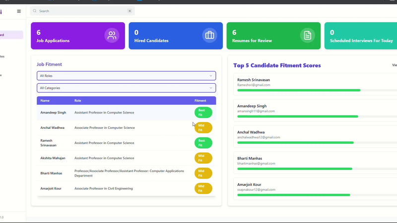
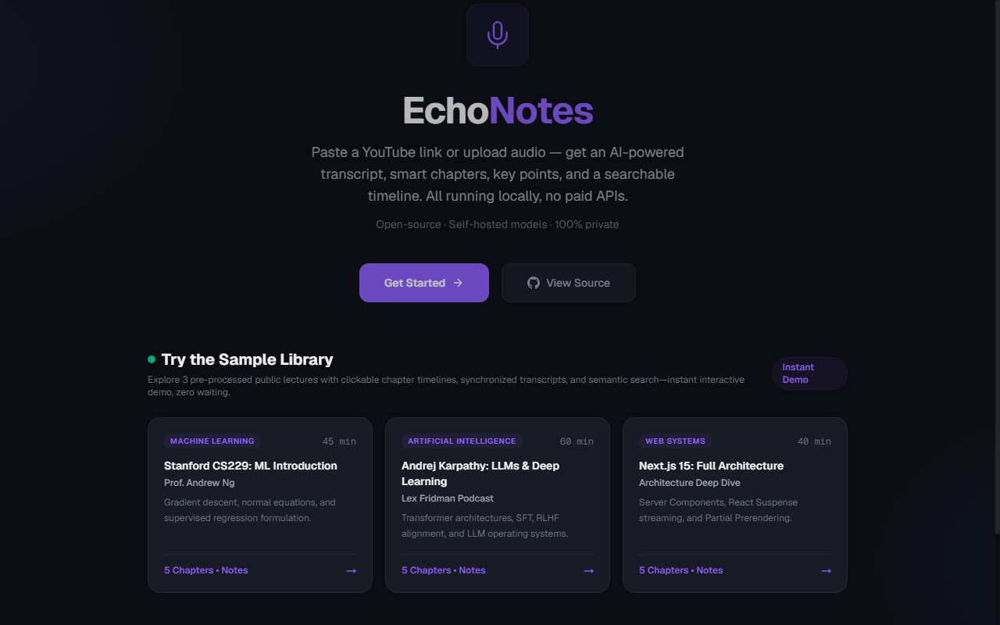

<!--
  AUTO-GENERATED FILE. DO NOT EDIT DIRECTLY.
  Source of truth: data/profile.yml
  Generated by: scripts/build_readme.py
-->

<picture>
  <source media="(prefers-color-scheme: dark)" srcset="assets/hero-dark.svg">
  <source media="(prefers-color-scheme: light)" srcset="assets/hero-light.svg">
  
</picture>

[🌐 Portfolio](https://sakshamsgupta-portfolio.vercel.app/) &nbsp;&nbsp;•&nbsp;&nbsp; [💼 LinkedIn](https://www.linkedin.com/in/saksham-gupta-458486294/) &nbsp;&nbsp;•&nbsp;&nbsp; [🐙 GitHub](https://github.com/sakshamgupta04) &nbsp;&nbsp;•&nbsp;&nbsp; [📄 Resume](https://sakshamsgupta-portfolio.vercel.app/Saksham_Gupta_Resume.pdf) &nbsp;&nbsp;•&nbsp;&nbsp; [✉️ Email](mailto:work.saksham04@gmail.com) &nbsp;&nbsp;•&nbsp;&nbsp; [🧩 LeetCode](https://leetcode.com/u/wupNOxI7hc/)

 

**Jump to:** [About](#about) &nbsp;•&nbsp; [Experience](#experience) &nbsp;•&nbsp; [Projects](#projects) &nbsp;•&nbsp; [Tech Stack](#skills) &nbsp;•&nbsp; [Focus Areas](#expertise) &nbsp;•&nbsp; [Research](#research) &nbsp;•&nbsp; [Certifications](#certifications) &nbsp;•&nbsp; [Education](#education) &nbsp;•&nbsp; [Contact](#contact)

---

<table width="100%">
<tr>
<td width="50%" valign="top">

<h3 style="margin-top: 0; margin-bottom: 8px;">👤 About Me </h3>

I'm <b>Saksham Gupta</b>, a Computer Science and Engineering graduate specializing in Artificial Intelligence and Machine Learning.

My work spans full-stack development, REST API engineering, machine learning, and cloud infrastructure. I enjoy building practical, end-to-end systems that solve real-world problems with reliable engineering practices.

</td>
<td width="50%" valign="top">

<h3 style="margin-top: 0; margin-bottom: 8px;">📊 At a Glance</h3>

<b>🎯 Target Roles:</b> Full-Stack / Web Developer &nbsp;•&nbsp; AI/ML Engineer &nbsp;•&nbsp; Software Engineer (SDE)

<b>🎓 Degree &amp; School:</b> B.Tech in Computer Science & Engineering (AI/ML) — Model Institute of Engineering and Technology, Jammu

<b>🗓️ Academic Period:</b> 2022 – 2026 &nbsp;|&nbsp; <b>CGPA 8.5/10</b>

<b>📍 Location:</b> Jammu, India

</td>
</tr>
</table>

---

## 💼 Professional Experience 

<table width="100%">
<tr>
<td width="50%" valign="top">

<h4 style="margin-top: 0; margin-bottom: 4px;">Software Development Engineer Intern (SDE Intern) </h4>

<b>Straatix Partners Labs Pvt. Ltd.</b> 📍 Whitefield, Bengaluru, India &nbsp;|&nbsp; 🗓️ January 2026 — July 2026

<ul>
  <li>Built and scaled React/Next.js portals for HR users and candidates, implementing dynamic interview scheduling and Supabase SSO/email authentication workflows.</li>
  <li>Migrated backend services to Google Cloud Platform, deploying containerized microservices on Cloud Run and integrating Vertex AI for production ML workflows.</li>
  <li>Engineered automated deployment pipelines with GitHub Actions and GCP Workload Identity Federation for keyless, secretless cloud delivery.</li>
</ul>

<b>Tech:</b> <code>React</code> &nbsp;<code>Next.js</code> &nbsp;<code>TypeScript</code> &nbsp;<code>Supabase</code> &nbsp;<code>Google Cloud Platform</code> &nbsp;<code>Cloud Run</code> &nbsp;<code>Vertex AI</code> &nbsp;<code>GitHub Actions</code> &nbsp;<code>Workload Identity Federation</code>

</td>
<td width="50%" valign="top">

<h4 style="margin-top: 0; margin-bottom: 4px;">AI/ML Developer Intern — Director Internship </h4>

<b>Model Institute of Engineering and Technology, Jammu</b> &nbsp;|&nbsp; 🗓️ February 2025 — January 2026

<ul>
  <li>Contributed to a patented evaluation engine analyzing candidate experience, Big Five personality traits, and career trajectory indicators.</li>
  <li>Implemented peer-group segmentation algorithms to enable fair, normalized candidate comparisons across varying backgrounds.</li>
  <li>Tuned and evaluated classification models to improve role-matching precision and candidate fit scoring.</li>
</ul>

<b>Tech:</b> <code>Python</code> &nbsp;<code>Scikit-learn</code> &nbsp;<code>Machine Learning</code> &nbsp;<code>Model Evaluation</code>

</td>
</tr>
</table>

---

## ⚡ Featured Projects 

<table width="100%">
<tr>
<td width="33%" valign="top">
  
  
  <h3 style="margin-top: 8px; margin-bottom: 4px;">People.ai &nbsp;Faculty Fit & Retention Prediction</h3>
  
An AI-driven faculty evaluation system designed to assess role suitability and predict long-term retention using professional experience, domain expertise, and career trajectory.

  <ul>
    <li>Engineered candidate profile features covering skill diversity, experience trends, and career longevity indicators.</li>
    <li>Trained and evaluated supervised classification models for faculty role fit and retention prediction.</li>
  </ul>
  

<code>Python</code> <code>Scikit-learn</code> <code>Gemini</code> <code>Model Evaluation</code>  

  

  <a href="https://sakshamsgupta-portfolio.vercel.app/projects/people-ai-faculty-fit">🔍 <b>Case Study ↗</b></a>
  

</td>
<td width="33%" valign="top">
  
  
  <h3 style="margin-top: 8px; margin-bottom: 4px;">AI Video Interview & Emotion Analyzer &nbsp;Real-Time Facial Expression & Emotion Telemetry</h3>
  
A web-based interview analysis platform that records video responses and processes facial expressions to generate structured emotion-analysis results.

  <ul>
    <li>Developed browser video recording with MediaRecorder API and multipart streaming to Supabase Storage.</li>
    <li>Built a frame-by-frame emotion telemetry pipeline using DeepFace and OpenCV Haar cascades.</li>
  </ul>
  

<code>Next.js</code> <code>Python</code> <code>DeepFace</code> <code>Supabase</code>  

  

  <a href="https://sakshamsgupta-portfolio.vercel.app/projects/ai-video-interview-emotion-analyzer">🔍 <b>Case Study ↗</b></a>
  

</td>
<td width="33%" valign="top">
  
  
  <h3 style="margin-top: 8px; margin-bottom: 4px;">EchoNotes &nbsp;AI-Powered Transcription & Semantic Search</h3>
  
An AI-powered application that converts audio and video content into structured transcripts, summaries, and searchable knowledge with timestamp-linked retrieval.

  <ul>
    <li>Developed audio ingestion and transcription workflows using captions and faster-whisper.</li>
    <li>Implemented semantic search using embeddings and timestamp-linked navigation.</li>
  </ul>
  

<code>Next.js</code> <code>FastAPI</code> <code>faster-whisper</code> <code>Supabase</code>  

  

  <a href="https://sakshamsgupta-portfolio.vercel.app/projects/echonotes">🔍 <b>Case Study ↗</b></a> &nbsp;|&nbsp; <a href="https://youtube-video-summarizer-sage.vercel.app/">▶️ <b>Live Site ↗</b></a> &nbsp;|&nbsp; <a href="https://github.com/sakshamgupta04/Youtube-Video-Summarizer">📦 <b>Source Code ↗</b></a>
  

</td>
</tr>
</table>

---

<table width="100%">
<tr>
<td width="50%" valign="top">

<h3 style="margin-top: 0; margin-bottom: 8px;">🛠️ Tech Stack </h3>

<b>Languages:</b> <code>Python</code> &nbsp;<code>C++</code> &nbsp;<code>Java</code> &nbsp;<code>JavaScript</code> &nbsp;<code>TypeScript</code> &nbsp;<code>SQL</code>

<b>Frontend:</b> <code>React</code> &nbsp;<code>Next.js</code> &nbsp;<code>HTML</code> &nbsp;<code>CSS</code>

<b>Backend & APIs:</b> <code>Node.js</code> &nbsp;<code>REST APIs</code> &nbsp;<code>Supabase Serverless Functions</code> &nbsp;<code>FastAPI</code>

<b>Databases:</b> <code>Supabase</code> &nbsp;<code>PostgreSQL</code> &nbsp;<code>Supabase Auth</code> &nbsp;<code>Supabase Storage</code>

<b>AI/ML:</b> <code>Scikit-learn</code> &nbsp;<code>TensorFlow</code> &nbsp;<code>PyTorch</code> &nbsp;<code>OpenCV</code> &nbsp;<code>DeepFace</code> &nbsp;<code>Pandas</code> &nbsp;<code>NumPy</code>

<b>Cloud & DevOps:</b> <code>Google Cloud Platform</code> &nbsp;<code>Cloud Run</code> &nbsp;<code>Vertex AI</code> &nbsp;<code>Docker</code> &nbsp;<code>GitHub Actions</code> &nbsp;<code>Workload Identity Federation</code>

<b>Developer Tools:</b> <code>Git</code> &nbsp;<code>GitHub</code> &nbsp;<code>VS Code</code> &nbsp;<code>Jupyter Notebook</code> &nbsp;<code>Airtable</code> &nbsp;<code>Claude</code>

</td>
<td width="50%" valign="top">

<h3 style="margin-top: 0; margin-bottom: 8px;">🎯 Core Focus Areas </h3>

<h4 style="margin-top: 8px; margin-bottom: 4px;">🧠 AI &amp; Machine Learning</h4>
<ul>
  <li>Applied Machine Learning &amp; Scikit-learn</li>
  <li>Computer Vision &amp; DeepFace</li>
  <li>Feature Engineering &amp; Hyperparameter Tuning</li>
  <li>Model Benchmarks &amp; Evaluation</li>
</ul>

<h4 style="margin-top: 8px; margin-bottom: 4px;">💻 Full-Stack Engineering</h4>
<ul>
  <li>React &amp; Next.js Application Architecture</li>
  <li>REST APIs &amp; FastAPI Microservices</li>
  <li>Supabase Auth, PostgreSQL &amp; Storage</li>
  <li>TypeScript Serverless Workflows</li>
</ul>

<h4 style="margin-top: 8px; margin-bottom: 4px;">☁️ Cloud &amp; Deployment</h4>
<ul>
  <li>Google Cloud Platform (GCP)</li>
  <li>Microservices on Cloud Run</li>
  <li>Vertex AI Production Pipelines</li>
  <li>Keyless CI/CD with GCP Workload Identity Federation</li>
</ul>
</td>
</tr>
</table>

---

## 📖 Research Publications 

- **Machine Learning-Based Approach for Diabetes Detection and Prediction**  
  *Saksham Gupta, Gandharv Kaloo, Palvi Sharma, Aarush Wali* &nbsp;•&nbsp; **IEEE 3rd International Conference on Advancement in Computation & Computer Technologies (InCACCT)** (2025)  
[🔗 **DOI**](https://doi.org/10.1109/InCACCT65424.2025.11011335) &nbsp;&nbsp;•&nbsp;&nbsp; [📄 **Full Paper / PDF**](https://sakshamsgupta-portfolio.vercel.app/papers/diabetes-risk-forecasting.pdf)

- **Evaluating the Accuracy and Computational Load of Booth's Algorithm and Vedic Multiplication in Digital Systems**  
  *Veena Tripathi, Saksham Gupta, Aarush Wali, Archit Bali, Aradhika Gandotra, Ayushman Vohra* &nbsp;•&nbsp; **Taylor & Francis / CRC Press** (2024)  
[🔗 **DOI**](https://doi.org/10.1201/9781003637530-29) &nbsp;&nbsp;•&nbsp;&nbsp; [📄 **Full Paper / PDF**](https://sakshamsgupta-portfolio.vercel.app/papers/booths-vedic-multiplication.pdf)

---

## 🎖️ Certifications &amp; Achievements 

| Credential Name | Issuer | Type | Verified Credential |
| :--- | :--- | :--- | :--- |
| **Machine Learning Foundations: A Case Study Approach** | Coursera | `Certification` | [Verify Credential](https://drive.google.com/file/d/1OEpAV99YcSLHiKTEZYi837R5TxQRKD5B/view?usp=sharing) |
| **Machine Learning: Clustering & Retrieval** | Coursera | `Certification` | [Verify Credential](https://drive.google.com/file/d/1ltixDuXfPTm9ZjuJG0D5CUbCBdMpZNC9/view?usp=sharing) |
| **The Joy of Computing Using Python** | NPTEL | `Certification` | [Verify Credential](https://drive.google.com/file/d/1WuVjc5FJYyqfh6lhZQ6vbLnY26bnvM-0/view?usp=sharing) |
| **GCP Associate Cloud Engineer Certification Training** | Udemy | `Course` | [Verify Credential](https://drive.google.com/file/d/1Bw5bg4Yojz2DPmFDPV0K1wRqYPpmOakV/view?usp=sharing) |
| **JavaScript — The Complete Guide** | Udemy | `Course` | [Verify Credential](https://drive.google.com/file/d/17mlMA4FOzjRV_1lhhy4L5Zpctv_hgzN5/view?usp=sharing) |
| **The Complete Guide to Airtable** | Udemy | `Course` | [Verify Credential](https://drive.google.com/file/d/1q7hdYtMm1DiE9gZC5GZ4lBmBxF8WlWFG/view?usp=sharing) |

> ⭐ **Hands-on Training:** AI/ML Hands-on Training Program, Model Institute of Engineering and Technology (March 2025).

---

## 🎓 Education 

| Institution | Degree Program | Academic Period | CGPA Standing |
| :--- | :--- | :--- | :--- |
| **Model Institute of Engineering and Technology, Jammu** | B.Tech in Computer Science & Engineering (AI/ML) | 2022 — 2026 | **CGPA 8.5/10** |

---

## 🚀 Let's Connect 

I'm open to discussing software engineering opportunities, AI/ML projects, and technical collaborations. Feel free to explore my work or get in touch!

<a href="https://sakshamsgupta-portfolio.vercel.app/">🌐 <b>Portfolio Website ↗</b></a> &nbsp;&nbsp;|&nbsp;&nbsp; <a href="mailto:work.saksham04@gmail.com">✉️ <b>Email ↗</b></a> &nbsp;&nbsp;|&nbsp;&nbsp; <a href="https://www.linkedin.com/in/saksham-gupta-458486294/">💼 <b>LinkedIn ↗</b></a> &nbsp;&nbsp;|&nbsp;&nbsp; <a href="https://github.com/sakshamgupta04">🐙 <b>GitHub ↗</b></a> &nbsp;&nbsp;|&nbsp;&nbsp; <a href="https://leetcode.com/u/wupNOxI7hc/">🧩 <b>LeetCode ↗</b></a> &nbsp;&nbsp;|&nbsp;&nbsp; <a href="https://sakshamsgupta-portfolio.vercel.app/Saksham_Gupta_Resume.pdf">📄 <b>Résumé PDF ↗</b></a>

