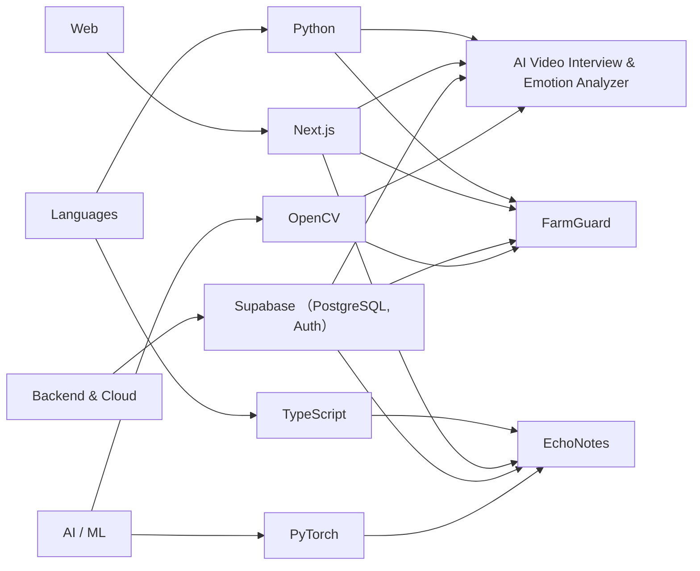

<!--
  AUTO-GENERATED FILE. DO NOT EDIT DIRECTLY.
  Source of truth: data/profile.yml
  Generated by: scripts/build_readme.py
-->

<picture>
  <source media="(prefers-color-scheme: dark)" srcset="assets/terminal-dark.svg">
  <source media="(prefers-color-scheme: light)" srcset="assets/terminal-light.svg">
  
</picture>

```text
sakshamgupta04@github:~$ whoami
name:     Saksham Gupta
role:     Full-stack developer and ML engineer
status:   Open to full-time roles: web development, AI/ML engineering, software engineering
sakshamgupta04@github:~$ █
```

> I build full-stack products and the machine learning behind them.

🟢 **Available:** Open to full-time roles: web development, AI/ML engineering, software engineering

<p align="left">
  [💼 LinkedIn](https://www.linkedin.com/in/saksham-gupta-458486294/) &nbsp;•&nbsp; [✉️ Email](mailto:work.saksham04@gmail.com) &nbsp;•&nbsp; [🧩 LeetCode](https://leetcode.com/u/wupNOxI7hc/)
</p>

---

**Jump to:** [About](#about) &nbsp;•&nbsp; [Start Here](#start-here) &nbsp;•&nbsp; [Skills](#skills) &nbsp;•&nbsp; [Roadmap &amp; Goals](#goals) &nbsp;•&nbsp; [Principles](#principles) &nbsp;•&nbsp; [Contact](#contact)

---

## 👤 About &amp; Overview <a id="about"></a>

```text
sakshamgupta04@github:~$ whoami
name:             Saksham Gupta
roles_targeted:   Full-Stack / Web Developer, AI/ML Engineer, Software Engineer (SDE)
education:        B.Tech, Computer Science & Engineering (AI/ML) | Model Institute of Engineering and Technology, Jammu (2022-2026, CGPA 8.5)
status:           Open to full-time roles: web development, AI/ML engineering, software engineering
```
---

## 🧭 Start Here <a id="start-here"></a>

<details open>
<summary><b>💼 Recruiter &amp; Hiring Manager</b> (TL;DR, key highlights, availability)</summary>

<br>

- **Availability:** Open to full-time roles: web development, AI/ML engineering, software engineering
- **Roles Targeted:** Full-Stack / Web Developer • AI/ML Engineer • Software Engineer (SDE)

**Top Featured Projects:**

- **EchoNotes**: Paste a YouTube link or upload a file; get chapters, key points, a summary and search that jumps to the exact moment.
- **AI Video Interview & Emotion Analyzer**: Record an interview in the browser and get frame-by-frame emotion analysis.
- **FarmGuard**: Edge-AI crop protection: detects animals raiding crops, deters them humanely, and alerts the farmer.
**Direct Contact:** [work.saksham04@gmail.com](mailto:work.saksham04@gmail.com) &nbsp;•&nbsp; [LinkedIn Profile](https://www.linkedin.com/in/saksham-gupta-458486294/)

</details>

<details>
<summary><b>🛠️ Software Engineer &amp; Tech Lead</b> (Architecture, codebases, stack)</summary>

<br>

**Key Projects &amp; Architectures:**

- **EchoNotes** (`shipped`): Paste a YouTube link or upload a file; get chapters, key points, a summary and search that jumps to the exact moment.
  - **Stack:** Next.js, TypeScript, FastAPI, Supabase, faster-whisper, PyTorch
  - **Architecture:** Input ladder: captions first, then audio download plus Whisper, then file upload

- **AI Video Interview & Emotion Analyzer** (`shipped`): Record an interview in the browser and get frame-by-frame emotion analysis.
  - **Stack:** Next.js, Python, DeepFace, OpenCV, Supabase
  - **Architecture:** In-browser recording with the MediaRecorder API and multipart upload

- **FarmGuard** (`building`): Edge-AI crop protection: detects animals raiding crops, deters them humanely, and alerts the farmer.
  - **Stack:** Python, ONNX Runtime, OpenCV, FastAPI, Next.js, Supabase
  - **Architecture:** Two-stage recognition: generic animal detector plus a species classifier

- **PaperLens** (`planned`): Private research-paper analyzer that runs entirely in the browser, with cited answers.
  - **Stack:** React, TypeScript, Transformers.js, WebLLM, pdf.js

</details>


---

## 🛠️ Skills &amp; Tech Stack <a id="skills"></a>

### 🗺️ Skill-to-Project Graph




### 💻 Competencies by Category

#### Languages

| Technology / Skill | Level |
|:---|:---|
| **Python** |  |
| **TypeScript** |  |
| **JavaScript** |  |
| **C++** |  |
| **Java** |  |
| **SQL** |  |

#### Web

| Technology / Skill | Level |
|:---|:---|
| **React** |  |
| **Next.js** |  |
| **Node.js** |  |
| **HTML/CSS** |  |
| **REST APIs** |  |

#### Backend & Cloud

| Technology / Skill | Level |
|:---|:---|
| **Supabase (PostgreSQL, Auth)** |  |
| **Google Cloud (Cloud Run, Vertex AI)** |  |

#### AI / ML

| Technology / Skill | Level |
|:---|:---|
| **Scikit-learn** |  |
| **PyTorch** |  |
| **TensorFlow** |  |
| **OpenCV** |  |
| **Pandas / NumPy** |  |
| **Model evaluation** |  |

#### Tools

| Technology / Skill | Level |
|:---|:---|
| **Git / GitHub** |  |
| **Jupyter** |  |

#### Fundamentals

| Technology / Skill | Level |
|:---|:---|
| **Data structures & algorithms** |  |
| **Object-oriented programming** |  |
| **System design** |  |


---

## 🎯 Mission &amp; Goals <a id="goals"></a>

### Objectives

**Short-Term Focus:**
- Join a team as a full-stack or ML engineer and ship production features
- Ship projects with live demos and measured results, not just notebooks

**Mid-Term Focus:**
- Publish and present more research
- Contribute to open-source ML and web tooling

**Long-Term Vision:**
- Build AI products that solve real problems for real people


### 🗺️ Engineering Roadmap

| Status | Milestone |
|:---|:---|
| ✅ Done | Portfolio website live |
| ⚡ In progress (doing) | FarmGuard PC prototype with evaluation |
| 📋 Next (planned) | PaperLens: private in-browser document analyzer |
| 📋 Next (planned) | First open-source contribution |


---

## 📐 Working Principles <a id="principles"></a>

| Principle | How It Shows Up |
|:---|:---|
| **Measure before you claim** | Every ML project gets a baseline and an evaluation. Numbers on my resume come from runs I can reproduce. |
| **Fail gracefully** | Each feature has a fallback, so one broken dependency never breaks the whole product. |
| **Privacy by design** | Prefer on-device and offline processing when it is practical. |
| **Ship it** | A deployed link and a clear README beat an unfinished repository. |


---

## 📬 Get in Touch <a id="contact"></a>

🟢 **Current Status:** Open to full-time roles: web development, AI/ML engineering, software engineering

- **Email:** [work.saksham04@gmail.com](mailto:work.saksham04@gmail.com)
- **LinkedIn:** [Saksham Gupta](https://www.linkedin.com/in/saksham-gupta-458486294/)
- **LeetCode:** [sakshamgupta04](https://leetcode.com/u/wupNOxI7hc/)
- **GitHub:** [sakshamgupta04](https://github.com/sakshamgupta04)
