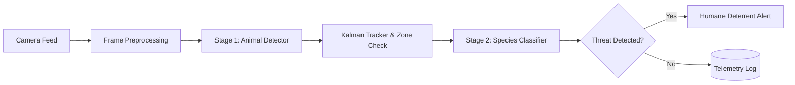

<!--
  AUTO-GENERATED FILE. DO NOT EDIT DIRECTLY.
  Source of truth: data/profile.yml
  Generated by: scripts/build_readme.py
-->

<picture>
  <source media="(prefers-color-scheme: dark)" srcset="assets/terminal-dark.svg">
  <source media="(prefers-color-scheme: light)" srcset="assets/terminal-light.svg">
  
</picture>

# Hey, I'm Saksham Gupta 👋
## Full-stack developer and ML engineer

> I build full-stack products and the machine learning behind them.

🟢 **Status:** Open to full-time roles: Full-Stack Developer, AI/ML Engineer, Software Engineer (SDE)

  [💼 LinkedIn](https://www.linkedin.com/in/saksham-gupta-458486294/) &nbsp;•&nbsp; [✉️ Email](mailto:work.saksham04@gmail.com) &nbsp;•&nbsp; [🧩 LeetCode](https://leetcode.com/u/wupNOxI7hc/)

---

**Jump to:** [About](#about) &nbsp;•&nbsp; [Projects](#projects) &nbsp;•&nbsp; [Skills](#skills) &nbsp;•&nbsp; [Contact](#contact)

---

## 👨‍💻 About Me 

I'm **Saksham Gupta**, a Full-stack developer and ML engineer. I build end-to-end software systems, combining modern web technologies with practical machine learning to solve real problems.

| Profile Overview | Details |
| :--- | :--- |
| 🎯 **Target Roles** | Full-Stack / Web Developer &nbsp;•&nbsp; AI/ML Engineer &nbsp;•&nbsp; Software Engineer (SDE) |
| 🎓 **Education** | B.Tech, Computer Science & Engineering (AI/ML) — Model Institute of Engineering and Technology, Jammu (2022–2026, **CGPA 8.5**) |

---

## 🚀 Featured Projects &amp; Work 

### Overview Matrix

| Project | Status | Core Stack | Links | Last Updated |
|:---|:---|:---|:---|:---|
| [**EchoNotes**](#echonotes) | 🚀 Shipped | Next.js, TypeScript, FastAPI +3 | — | — |
| [**AI Video Interview & Emotion Analyzer**](#ai-video-interview-emotion-analyzer) | 🚀 Shipped | Next.js, Python, DeepFace +2 | — | — |
| [**FarmGuard**](#farmguard) | 🔨 Building | Python, ONNX Runtime, OpenCV +3 | [Code](https://github.com/sakshamgupta04/Farmland-Animal-Detection) | 2026-11-12 |
| [**PaperLens**](#paperlens) | 💡 Planned | React, TypeScript, Transformers.js +2 | — | — |
| [**People.ai: Faculty Fit & Retention Prediction**](#people-ai) | 🚀 Shipped | Python, Scikit-learn, Pandas +1 | — | — |
| [**Straatix Talent Exchange Platform**](#straatix-talent-exchange) | 🚀 Shipped | Next.js, React, TypeScript +2 | — | — |

---

### EchoNotes 

> Paste a YouTube link or upload a file; get chapters, key points, a summary and search that jumps to the exact moment.

**Status:** 🚀 Shipped &nbsp;•&nbsp; ⭐ **Featured Project**
**Technologies:** <code>Next.js</code> &nbsp;•&nbsp; <code>TypeScript</code> &nbsp;•&nbsp; <code>FastAPI</code> &nbsp;•&nbsp; <code>Supabase</code> &nbsp;•&nbsp; <code>faster-whisper</code> &nbsp;•&nbsp; <code>PyTorch</code>
**Key Highlights:**
- Input ladder: captions first, then audio download plus Whisper, then file upload
- Embedding-based chapters and semantic search linked to timestamps

 

---
### AI Video Interview & Emotion Analyzer 

> Record an interview in the browser and get frame-by-frame emotion analysis.

**Status:** 🚀 Shipped &nbsp;•&nbsp; ⭐ **Featured Project**
**Technologies:** <code>Next.js</code> &nbsp;•&nbsp; <code>Python</code> &nbsp;•&nbsp; <code>DeepFace</code> &nbsp;•&nbsp; <code>OpenCV</code> &nbsp;•&nbsp; <code>Supabase</code>
**Key Highlights:**
- In-browser recording with the MediaRecorder API and multipart upload
- Emotion distributions and dominant emotion per answer

 

---
### FarmGuard 

> Edge-AI crop protection: detects animals raiding crops, deters them humanely, and alerts the farmer.

**Status:** 🔨 Building &nbsp;•&nbsp; ⭐ **Featured Project**
**Technologies:** <code>Python</code> &nbsp;•&nbsp; <code>ONNX Runtime</code> &nbsp;•&nbsp; <code>OpenCV</code> &nbsp;•&nbsp; <code>FastAPI</code> &nbsp;•&nbsp; <code>Next.js</code> &nbsp;•&nbsp; <code>Supabase</code>
**Key Highlights:**
- Two-stage recognition: generic animal detector plus a species classifier
- Offline-first, with tracking, zones, voting and person suppression

**Links:** [📦 **Repository**](https://github.com/sakshamgupta04/Farmland-Animal-Detection)

<b>📐 System Architecture Diagram</b>

 

 

---
### PaperLens 

> Private research-paper analyzer that runs entirely in the browser, with cited answers.

**Status:** 💡 Planned
**Technologies:** <code>React</code> &nbsp;•&nbsp; <code>TypeScript</code> &nbsp;•&nbsp; <code>Transformers.js</code> &nbsp;•&nbsp; <code>WebLLM</code> &nbsp;•&nbsp; <code>pdf.js</code>

 

---
### People.ai: Faculty Fit & Retention Prediction 

> Predicts faculty-role fit and long-term retention from profile data.

**Status:** 🚀 Shipped
**Technologies:** <code>Python</code> &nbsp;•&nbsp; <code>Scikit-learn</code> &nbsp;•&nbsp; <code>Pandas</code> &nbsp;•&nbsp; <code>NumPy</code>
**Key Highlights:**
- Feature engineering from resume and career-longevity signals

 

---
### Straatix Talent Exchange Platform 

> A two-sided hiring platform with separate HR and candidate portals.

**Status:** 🚀 Shipped
**Technologies:** <code>Next.js</code> &nbsp;•&nbsp; <code>React</code> &nbsp;•&nbsp; <code>TypeScript</code> &nbsp;•&nbsp; <code>Supabase</code> &nbsp;•&nbsp; <code>GCP</code>
**Key Highlights:**
- Role-specific dashboards and a real-time notification system

---

## 🛠️ Skills &amp; Tech Stack 

### 💻 Technical Competencies

| Domain | Technologies &amp; Frameworks |
| :--- | :--- |
| **Languages** | <code>Python</code> &nbsp;•&nbsp; <code>TypeScript</code> &nbsp;•&nbsp; <code>JavaScript</code> &nbsp;•&nbsp; <code>C++</code> &nbsp;•&nbsp; <code>Java</code> &nbsp;•&nbsp; <code>SQL</code> |
| **Web** | <code>React</code> &nbsp;•&nbsp; <code>Next.js</code> &nbsp;•&nbsp; <code>Node.js</code> &nbsp;•&nbsp; <code>HTML/CSS</code> &nbsp;•&nbsp; <code>REST APIs</code> |
| **Backend & Cloud** | <code>Supabase (PostgreSQL, Auth)</code> &nbsp;•&nbsp; <code>Google Cloud (Cloud Run, Vertex AI)</code> |
| **AI / ML** | <code>Scikit-learn</code> &nbsp;•&nbsp; <code>PyTorch</code> &nbsp;•&nbsp; <code>TensorFlow</code> &nbsp;•&nbsp; <code>OpenCV</code> &nbsp;•&nbsp; <code>Pandas / NumPy</code> &nbsp;•&nbsp; <code>Model evaluation</code> |
| **Tools** | <code>Git / GitHub</code> &nbsp;•&nbsp; <code>Jupyter</code> |
| **Fundamentals** | <code>Data structures & algorithms</code> &nbsp;•&nbsp; <code>Object-oriented programming</code> &nbsp;•&nbsp; <code>System design</code> |

---

## 🤝 Let's Connect 

Whether you have an interesting engineering challenge, a collaboration idea, or an opportunity, feel free to reach out:

[✉️ **Email**](mailto:work.saksham04@gmail.com) &nbsp;&nbsp;•&nbsp;&nbsp; [💼 **LinkedIn**](https://www.linkedin.com/in/saksham-gupta-458486294/) &nbsp;&nbsp;•&nbsp;&nbsp; [🐙 **GitHub**](https://github.com/sakshamgupta04) &nbsp;&nbsp;•&nbsp;&nbsp; [🧩 **LeetCode**](https://leetcode.com/u/wupNOxI7hc/)

