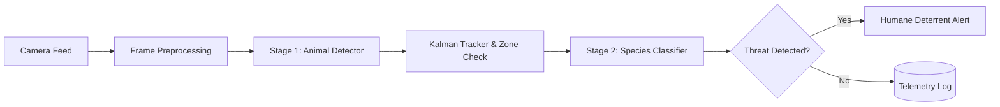

<!--
  AUTO-GENERATED FILE. DO NOT EDIT DIRECTLY.
  Source of truth: data/profile.yml
  Generated by: scripts/build_readme.py
-->

<picture>
  <source media="(prefers-color-scheme: dark)" srcset="assets/terminal-dark.svg">
  <source media="(prefers-color-scheme: light)" srcset="assets/terminal-light.svg">
  
</picture>

# Hey, I'm Saksham Gupta 👋
## Full-stack developer and ML engineer

> I build full-stack products and the machine learning behind them.

🟢 **Status:** Open to full-time roles: Full-Stack Developer, AI/ML Engineer, Software Engineer (SDE)

  [💼 LinkedIn](https://www.linkedin.com/in/saksham-gupta-458486294/) &nbsp;•&nbsp; [✉️ Email](mailto:work.saksham04@gmail.com) &nbsp;•&nbsp; [🧩 LeetCode](https://leetcode.com/u/wupNOxI7hc/)

---

**Jump to:** [About](#about) &nbsp;•&nbsp; [Projects](#projects) &nbsp;•&nbsp; [Skills](#skills) &nbsp;•&nbsp; [Experience](#experience) &nbsp;•&nbsp; [Contact](#contact)

---

## 👨‍💻 About Me 

I'm **Saksham Gupta**, a Full-stack developer and ML engineer. I build end-to-end software systems, combining modern web technologies with practical machine learning to solve real problems.

- 🎯 **Target Roles:** Full-Stack / Web Developer &nbsp;•&nbsp; AI/ML Engineer &nbsp;•&nbsp; Software Engineer (SDE)
- 🎓 **Education:** B.Tech, Computer Science & Engineering (AI/ML) — Model Institute of Engineering and Technology, Jammu (2022–2026, CGPA 8.5)

---

## 🚀 Featured Projects &amp; Work 

### Overview Matrix

| Project | Status | Core Stack | Links | Last Updated |
|:---|:---|:---|:---|:---|
| [**EchoNotes**](#echonotes) | 🚀 Shipped | Next.js, TypeScript, FastAPI +3 | — | — |
| [**AI Video Interview & Emotion Analyzer**](#ai-video-interview-emotion-analyzer) | 🚀 Shipped | Next.js, Python, DeepFace +2 | — | — |
| [**FarmGuard**](#farmguard) | 🔨 Building | Python, ONNX Runtime, OpenCV +3 | [Code](https://github.com/sakshamgupta04/Farmland-Animal-Detection) | 2026-11-12 |
| [**PaperLens**](#paperlens) | 💡 Planned | React, TypeScript, Transformers.js +2 | — | — |
| [**People.ai: Faculty Fit & Retention Prediction**](#people-ai) | 🚀 Shipped | Python, Scikit-learn, Pandas +1 | — | — |
| [**Straatix Talent Exchange Platform**](#straatix-talent-exchange) | 🚀 Shipped | Next.js, React, TypeScript +2 | — | — |

---

### EchoNotes 

**Status:** 🚀 Shipped &nbsp;•&nbsp; ⭐ *Featured Project*
> Paste a YouTube link or upload a file; get chapters, key points, a summary and search that jumps to the exact moment.

**Stack:** `Next.js` &nbsp;•&nbsp; `TypeScript` &nbsp;•&nbsp; `FastAPI` &nbsp;•&nbsp; `Supabase` &nbsp;•&nbsp; `faster-whisper` &nbsp;•&nbsp; `PyTorch`
**Key Highlights:**
- Input ladder: captions first, then audio download plus Whisper, then file upload
- Embedding-based chapters and semantic search linked to timestamps

 
### AI Video Interview & Emotion Analyzer 

**Status:** 🚀 Shipped &nbsp;•&nbsp; ⭐ *Featured Project*
> Record an interview in the browser and get frame-by-frame emotion analysis.

**Stack:** `Next.js` &nbsp;•&nbsp; `Python` &nbsp;•&nbsp; `DeepFace` &nbsp;•&nbsp; `OpenCV` &nbsp;•&nbsp; `Supabase`
**Key Highlights:**
- In-browser recording with the MediaRecorder API and multipart upload
- Emotion distributions and dominant emotion per answer

 
### FarmGuard 

**Status:** 🔨 Building &nbsp;•&nbsp; ⭐ *Featured Project*
> Edge-AI crop protection: detects animals raiding crops, deters them humanely, and alerts the farmer.

**Stack:** `Python` &nbsp;•&nbsp; `ONNX Runtime` &nbsp;•&nbsp; `OpenCV` &nbsp;•&nbsp; `FastAPI` &nbsp;•&nbsp; `Next.js` &nbsp;•&nbsp; `Supabase`
**Key Highlights:**
- Two-stage recognition: generic animal detector plus a species classifier
- Offline-first, with tracking, zones, voting and person suppression

**Project Links:** [📦 Repository](https://github.com/sakshamgupta04/Farmland-Animal-Detection)

🏗️ Architecture &amp; System Diagram

 
### PaperLens 

**Status:** 💡 Planned
> Private research-paper analyzer that runs entirely in the browser, with cited answers.

**Stack:** `React` &nbsp;•&nbsp; `TypeScript` &nbsp;•&nbsp; `Transformers.js` &nbsp;•&nbsp; `WebLLM` &nbsp;•&nbsp; `pdf.js`

 
### People.ai: Faculty Fit & Retention Prediction 

**Status:** 🚀 Shipped
> Predicts faculty-role fit and long-term retention from profile data.

**Stack:** `Python` &nbsp;•&nbsp; `Scikit-learn` &nbsp;•&nbsp; `Pandas` &nbsp;•&nbsp; `NumPy`
**Key Highlights:**
- Feature engineering from resume and career-longevity signals

 
### Straatix Talent Exchange Platform 

**Status:** 🚀 Shipped
> A two-sided hiring platform with separate HR and candidate portals.

**Stack:** `Next.js` &nbsp;•&nbsp; `React` &nbsp;•&nbsp; `TypeScript` &nbsp;•&nbsp; `Supabase` &nbsp;•&nbsp; `GCP`
**Key Highlights:**
- Role-specific dashboards and a real-time notification system

---

## 🛠️ Skills &amp; Tech Stack 

### 💻 Core Technical Competencies

#### Languages

<code>Python</code> &nbsp;•&nbsp; <code>TypeScript</code> &nbsp;•&nbsp; <code>JavaScript</code> &nbsp;•&nbsp; <code>C++</code> &nbsp;•&nbsp; <code>Java</code> &nbsp;•&nbsp; <code>SQL</code>

#### Web

<code>React</code> &nbsp;•&nbsp; <code>Next.js</code> &nbsp;•&nbsp; <code>Node.js</code> &nbsp;•&nbsp; <code>HTML/CSS</code> &nbsp;•&nbsp; <code>REST APIs</code>

#### Backend & Cloud

<code>Supabase (PostgreSQL, Auth)</code> &nbsp;•&nbsp; <code>Google Cloud (Cloud Run, Vertex AI)</code>

#### AI / ML

<code>Scikit-learn</code> &nbsp;•&nbsp; <code>PyTorch</code> &nbsp;•&nbsp; <code>TensorFlow</code> &nbsp;•&nbsp; <code>OpenCV</code> &nbsp;•&nbsp; <code>Pandas / NumPy</code> &nbsp;•&nbsp; <code>Model evaluation</code>

#### Tools

<code>Git / GitHub</code> &nbsp;•&nbsp; <code>Jupyter</code>

#### Fundamentals

<code>Data structures & algorithms</code> &nbsp;•&nbsp; <code>Object-oriented programming</code> &nbsp;•&nbsp; <code>System design</code>

---

## 💼 Experience &amp; Engineering Roles 

### **SDE Intern** – Straatix Partners Labs Pvt. Ltd.
`2026-01 — 2026-07`

Key Contributions &amp; Impact

 

- Built and scaled React/Next.js portal features for HR users and candidates, including dynamic interview scheduling components.
- Implemented Supabase authentication with SSO and email sign-in flows, and wrote TypeScript serverless functions to automate the referral system.
- Led the migration of legacy systems to Google Cloud Platform, deploying services on Cloud Run and using Vertex AI for production ML pipelines.

 

**Technologies Used:** `React` &nbsp;•&nbsp; `Next.js` &nbsp;•&nbsp; `TypeScript` &nbsp;•&nbsp; `Supabase` &nbsp;•&nbsp; `GCP`

 
### **AI/ML Developer Intern (Director Internship)** – Model Institute of Engineering and Technology
`2025-02 — 2026-01`

Key Contributions &amp; Impact

 

- Contributed to a patented AI platform for candidate evaluation and role prediction, using ML models for experience, personality (Big Five) and career-trajectory analysis.
- Implemented peer-group segmentation for fair candidate comparison, improving role-matching accuracy through model tuning.

 

**Technologies Used:** `Python` &nbsp;•&nbsp; `Scikit-learn`

 
### **Trainee, AI/ML Hands-on Training Program** – Model Institute of Engineering and Technology
`2025-03 — 2025-03`

Key Contributions &amp; Impact

 

- Hands-on training in data preprocessing and model building on real-world datasets.

---

## 🤝 Let's Connect 

Interested in collaborating, discussing projects, or exploring engineering opportunities? Feel free to reach out:

[✉️ Email](mailto:work.saksham04@gmail.com) &nbsp;•&nbsp; [💼 LinkedIn](https://www.linkedin.com/in/saksham-gupta-458486294/) &nbsp;•&nbsp; [🐙 GitHub](https://github.com/sakshamgupta04) &nbsp;•&nbsp; [🧩 LeetCode](https://leetcode.com/u/wupNOxI7hc/)

