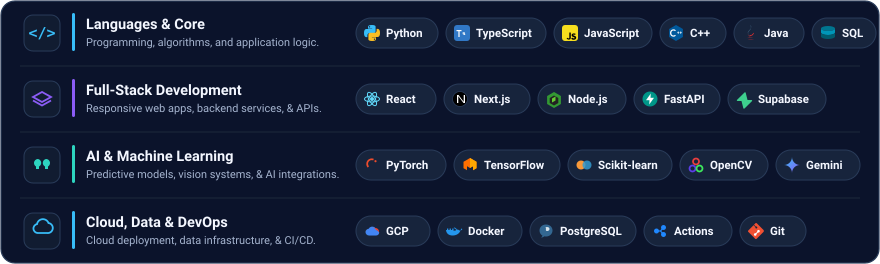

<!--
  AUTO-GENERATED FILE. DO NOT EDIT DIRECTLY.
  Source of truth: data/profile.yml
  Generated by: scripts/build_readme.py
-->

<picture>
  <source media="(prefers-color-scheme: dark)" srcset="assets/hero-dark.svg">
  <source media="(prefers-color-scheme: light)" srcset="assets/hero-light.svg">
  
</picture>

<!-- [🌐 Portfolio] --><a href="https://sakshamsgupta-portfolio.vercel.app/">🌐 <b>Portfolio Website ↗</b></a> &nbsp;&nbsp;•&nbsp;&nbsp; <!-- [🐙 GitHub] --><a href="https://github.com/sakshamgupta04">🐙 <b>GitHub ↗</b></a> &nbsp;&nbsp;•&nbsp;&nbsp; <!-- [💼 LinkedIn] --><a href="https://www.linkedin.com/in/saksham-gupta-458486294/">💼 <b>LinkedIn ↗</b></a> &nbsp;&nbsp;•&nbsp;&nbsp; <!-- [✉️ Email] --><a href="mailto:work.saksham04@gmail.com">✉️ <b>Email ↗</b></a> &nbsp;&nbsp;•&nbsp;&nbsp; <!-- [📄 Resume] --><a href="https://sakshamsgupta-portfolio.vercel.app/Saksham_Gupta_Resume.pdf">📄 <b>Resume ↓</b></a> &nbsp;&nbsp;•&nbsp;&nbsp; <!-- [🧩 LeetCode] --><a href="https://leetcode.com/u/wupNOxI7hc/">🧩 <b>LeetCode ↗</b></a>

**Jump to:** [About](#about) &nbsp;•&nbsp; [Experience](#experience) &nbsp;•&nbsp; [Projects](#projects) &nbsp;•&nbsp; [Tech Stack](#skills) &nbsp;•&nbsp; [Focus Areas](#expertise) &nbsp;•&nbsp; [Research](#research) &nbsp;•&nbsp; [Certifications](#certifications) &nbsp;•&nbsp; [Education](#education) &nbsp;•&nbsp; [Contact](#contact)

---

## 👤 About Me 

I'm **Saksham Gupta**, a Computer Science and Engineering graduate from **Model Institute of Engineering and Technology, Jammu** specializing in Artificial Intelligence and Machine Learning.

**🎯 Target Roles:** Full-Stack / Web Developer &nbsp;•&nbsp; AI/ML Engineer &nbsp;•&nbsp; Software Engineer (SDE)

---

## 💼 Professional Experience 

### Straatix Partners Labs Pvt. Ltd. 
**Software Development Engineer Intern (SDE Intern)** &nbsp;•&nbsp; 🗓️ January 2026 — July 2026 &nbsp;•&nbsp; 📍 Whitefield, Bengaluru, India

- Built and scaled React/Next.js portals for HR users and candidates, implementing dynamic interview scheduling and Supabase SSO/email authentication workflows.
- Migrated backend services to Google Cloud Platform, deploying containerized microservices on Cloud Run and integrating Vertex AI for production ML workflows.
- Engineered automated deployment pipelines with GitHub Actions and GCP Workload Identity Federation for keyless, secretless cloud delivery.

**Technologies:** <code>React</code> &nbsp;•&nbsp; <code>Next.js</code> &nbsp;•&nbsp; <code>TypeScript</code> &nbsp;•&nbsp; <code>Supabase</code> &nbsp;•&nbsp; <code>Google Cloud Platform</code> &nbsp;•&nbsp; <code>Cloud Run</code> &nbsp;•&nbsp; <code>Vertex AI</code> &nbsp;•&nbsp; <code>GitHub Actions</code> &nbsp;•&nbsp; <code>Workload Identity Federation</code>

---

### Model Institute of Engineering and Technology, Jammu 
**AI/ML Developer Intern — Director Internship** &nbsp;•&nbsp; 🗓️ February 2025 — January 2026

- Contributed to a patented evaluation engine analyzing candidate experience, Big Five personality traits, and career trajectory indicators.
- Implemented peer-group segmentation algorithms to enable fair, normalized candidate comparisons across varying backgrounds.
- Tuned and evaluated classification models to improve role-matching precision and candidate fit scoring.

**Technologies:** <code>Python</code> &nbsp;•&nbsp; <code>Scikit-learn</code> &nbsp;•&nbsp; <code>Machine Learning</code> &nbsp;•&nbsp; <code>Model Evaluation</code>

---

## ⚡ Featured Projects 

  

### 01 &nbsp; People.ai
**Faculty Fit & Retention Prediction**

  An AI-driven faculty evaluation system designed to assess role suitability and predict long-term retention using professional experience, domain expertise, and career trajectory.

**Key Engineering Highlights:**

- Engineered candidate profile features covering skill diversity, experience trends, and career longevity indicators.
- Trained and evaluated supervised classification models for faculty role fit and retention prediction.

  <b>Technologies:</b> &nbsp;<code>Python</code> &nbsp;•&nbsp; <code>Scikit-learn</code> &nbsp;•&nbsp; <code>Gemini</code> &nbsp;•&nbsp; <code>Model Evaluation</code>

<a href="https://sakshamsgupta-portfolio.vercel.app/projects/people-ai-faculty-fit">🔍 <b>Case Study ↗</b></a>

---

  

### 02 &nbsp; AI Video Interview & Emotion Analyzer
**Real-Time Facial Expression & Emotion Telemetry**

  A web-based interview analysis platform that records video responses and processes facial expressions to generate structured emotion-analysis results.

**Key Engineering Highlights:**

- Developed browser video recording with MediaRecorder API and multipart streaming to Supabase Storage.
- Built a frame-by-frame emotion telemetry pipeline using DeepFace and OpenCV Haar cascades.

  <b>Technologies:</b> &nbsp;<code>Next.js</code> &nbsp;•&nbsp; <code>Python</code> &nbsp;•&nbsp; <code>DeepFace</code> &nbsp;•&nbsp; <code>Supabase</code>

<a href="https://sakshamsgupta-portfolio.vercel.app/projects/ai-video-interview-emotion-analyzer">🔍 <b>Case Study ↗</b></a>

---

  

### 03 &nbsp; EchoNotes
**AI-Powered Transcription & Semantic Search**

  An AI-powered application that converts audio and video content into structured transcripts, summaries, and searchable knowledge with timestamp-linked retrieval.

**Key Engineering Highlights:**

- Developed audio ingestion and transcription workflows using captions and faster-whisper.
- Implemented semantic search using embeddings and timestamp-linked navigation.

  <b>Technologies:</b> &nbsp;<code>Next.js</code> &nbsp;•&nbsp; <code>FastAPI</code> &nbsp;•&nbsp; <code>faster-whisper</code> &nbsp;•&nbsp; <code>Supabase</code>

<a href="https://sakshamsgupta-portfolio.vercel.app/projects/echonotes">🔍 <b>Case Study ↗</b></a> &nbsp;&nbsp;|&nbsp;&nbsp; <a href="https://youtube-video-summarizer-sage.vercel.app/">▶️ <b>Live Site ↗</b></a> &nbsp;&nbsp;|&nbsp;&nbsp; <a href="https://github.com/sakshamgupta04/Youtube-Video-Summarizer">📦 <b>Source Code ↗</b></a>

---

## 🛠️ Technical Stack 

<picture>
  <source media="(max-width: 600px) and (prefers-color-scheme: dark)" srcset="assets/tech-stack-mobile-dark.svg">
  <source media="(max-width: 600px) and (prefers-color-scheme: light)" srcset="assets/tech-stack-mobile-light.svg">
  <source media="(max-width: 600px)" srcset="assets/tech-stack-mobile-dark.svg">
  <source media="(prefers-color-scheme: dark)" srcset="assets/tech-stack-dark.svg">
  <source media="(prefers-color-scheme: light)" srcset="assets/tech-stack-light.svg">
  
</picture>

  <b>Additional Tools &amp; Technologies:</b> &nbsp;<code>Pandas</code> &nbsp;•&nbsp; <code>NumPy</code> &nbsp;•&nbsp; <code>DeepFace</code> &nbsp;•&nbsp; <code>Cloud Run</code> &nbsp;•&nbsp; <code>Vertex AI</code> &nbsp;•&nbsp; <code>Workload Identity Federation</code> &nbsp;•&nbsp; <code>Jupyter Notebook</code>

---

## 🎯 Core Focus Areas 

### 🧠 AI &amp; Machine Learning
Developing predictive models, supervised classification pipelines, computer vision systems, and feature engineering with scikit-learn, TensorFlow, and PyTorch. Rigorous focus on model evaluation, validation metrics, and production inference.

### 💻 Full-Stack Engineering
Architecting end-to-end web applications with React, Next.js, and TypeScript, backed by robust RESTful APIs in FastAPI and Node.js. Persistent state management, real-time sync, and database design with Supabase and PostgreSQL.

### ☁️ Cloud &amp; Infrastructure
Containerizing microservices with Docker and deploying serverless workloads to Google Cloud Platform (Cloud Run, Vertex AI). Implementing keyless, secure CI/CD pipelines using GitHub Actions and GCP Workload Identity Federation.

---

## 📖 Research Publications 

### Machine Learning-Based Approach for Diabetes Detection and Prediction
*Saksham Gupta, Gandharv Kaloo, Palvi Sharma, Aarush Wali* &nbsp;•&nbsp; **IEEE 3rd International Conference on Advancement in Computation & Computer Technologies (InCACCT)** (2025)
[🔗 **DOI**](https://doi.org/10.1109/InCACCT65424.2025.11011335) &nbsp;&nbsp;|&nbsp;&nbsp; [📄 **Full Paper / PDF**](https://sakshamsgupta-portfolio.vercel.app/papers/diabetes-risk-forecasting.pdf)

---

### Evaluating the Accuracy and Computational Load of Booth's Algorithm and Vedic Multiplication in Digital Systems
*Veena Tripathi, Saksham Gupta, Aarush Wali, Archit Bali, Aradhika Gandotra, Ayushman Vohra* &nbsp;•&nbsp; **Taylor & Francis / CRC Press** (2024)
[🔗 **DOI**](https://doi.org/10.1201/9781003637530-29) &nbsp;&nbsp;|&nbsp;&nbsp; [📄 **Full Paper / PDF**](https://sakshamsgupta-portfolio.vercel.app/papers/booths-vedic-multiplication.pdf)

---

## 🎖️ Certifications &amp; Achievements 

<table>
  <thead>
    <tr>
      <th width="50%" align="left">🧠 AI &amp; Machine Learning</th>
      <th width="50%" align="left">☁️ Cloud &amp; Development</th>
    </tr>
  </thead>
  <tbody>
    <tr>
      <td valign="top">
        
<strong>Machine Learning Foundations: A Case Study Approach</strong> Coursera · Certification · <a href="https://drive.google.com/file/d/1OEpAV99YcSLHiKTEZYi837R5TxQRKD5B/view?usp=sharing">View credential ↗</a>

        
<strong>Machine Learning: Clustering & Retrieval</strong> Coursera · Certification · <a href="https://drive.google.com/file/d/1ltixDuXfPTm9ZjuJG0D5CUbCBdMpZNC9/view?usp=sharing">View credential ↗</a>

        
<strong>The Joy of Computing Using Python</strong> NPTEL · Certification · <a href="https://drive.google.com/file/d/1WuVjc5FJYyqfh6lhZQ6vbLnY26bnvM-0/view?usp=sharing">View credential ↗</a>

      </td>
      <td valign="top">
        
<strong>GCP Associate Cloud Engineer Certification Training</strong> Udemy · Course · <a href="https://drive.google.com/file/d/1Bw5bg4Yojz2DPmFDPV0K1wRqYPpmOakV/view?usp=sharing">View credential ↗</a>

        
<strong>JavaScript — The Complete Guide</strong> Udemy · Course · <a href="https://drive.google.com/file/d/17mlMA4FOzjRV_1lhhy4L5Zpctv_hgzN5/view?usp=sharing">View credential ↗</a>

        
<strong>The Complete Guide to Airtable</strong> Udemy · Course · <a href="https://drive.google.com/file/d/1q7hdYtMm1DiE9gZC5GZ4lBmBxF8WlWFG/view?usp=sharing">View credential ↗</a>

      </td>
    </tr>
  </tbody>
</table>

> 🏆 **Practical AI/ML Training** · Model Institute of Engineering and Technology · March 2025
>
> AI/ML Hands-on Training Program

---

## 🎓 Education 

### Model Institute of Engineering and Technology, Jammu
**B.Tech in Computer Science & Engineering (AI/ML)** &nbsp;•&nbsp; 🗓️ 2022 — 2026
> **Academic Standing:** CGPA 8.5/10

---

## 🚀 Let's Connect 

I'm actively looking for software engineering, AI/ML, and full-stack development opportunities. Whether you have an open role, an engineering challenge, or want to discuss technical projects, feel free to reach out!

[🌐 **Portfolio**](https://sakshamsgupta-portfolio.vercel.app/) &nbsp;&nbsp;•&nbsp;&nbsp; [✉️ **Email**](mailto:work.saksham04@gmail.com) &nbsp;&nbsp;•&nbsp;&nbsp; [💼 **LinkedIn**](https://www.linkedin.com/in/saksham-gupta-458486294/) &nbsp;&nbsp;•&nbsp;&nbsp; [🐙 **GitHub**](https://github.com/sakshamgupta04) &nbsp;&nbsp;•&nbsp;&nbsp; [🧩 **LeetCode**](https://leetcode.com/u/wupNOxI7hc/) &nbsp;&nbsp;•&nbsp;&nbsp; [📄 **Resume**](https://sakshamsgupta-portfolio.vercel.app/Saksham_Gupta_Resume.pdf)

