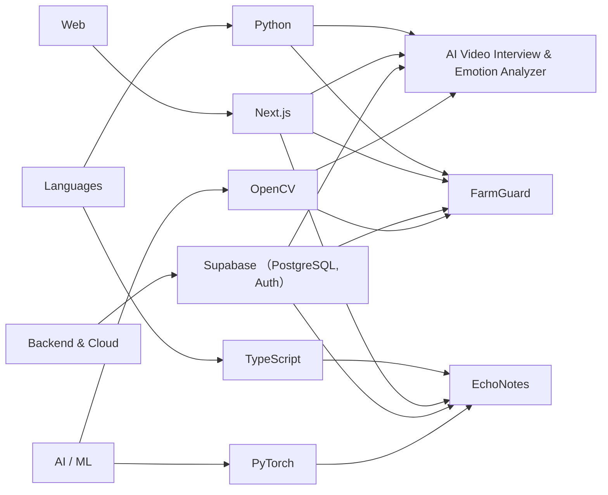
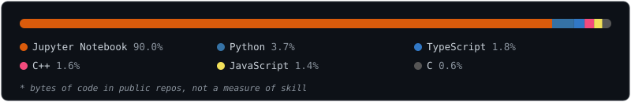

<!--
  AUTO-GENERATED FILE. DO NOT EDIT DIRECTLY.
  Source of truth: data/profile.yml
  Generated by: scripts/build_readme.py
-->

<picture>
  <source media="(prefers-color-scheme: dark)" srcset="assets/terminal-dark.svg">
  <source media="(prefers-color-scheme: light)" srcset="assets/terminal-light.svg">
  
</picture>

```text
sakshamgupta04@github:~$ whoami
name:     Saksham Gupta
role:     Full-stack developer and ML engineer
status:   Open to full-time roles: web development, AI/ML engineering, software engineering
sakshamgupta04@github:~$ █
```

> I build full-stack products and the machine learning behind them.

🟢 **Available:** Open to full-time roles: web development, AI/ML engineering, software engineering

<p align="left">
  [💼 LinkedIn](https://www.linkedin.com/in/saksham-gupta-458486294/) &nbsp;•&nbsp; [✉️ Email](mailto:work.saksham04@gmail.com) &nbsp;•&nbsp; [🧩 LeetCode](https://leetcode.com/u/wupNOxI7hc/)
</p>

---

**Jump to:** [About](#about) &nbsp;•&nbsp; [Start Here](#start-here) &nbsp;•&nbsp; [Projects](#projects) &nbsp;•&nbsp; [Skills](#skills) &nbsp;•&nbsp; [Experience](#experience) &nbsp;•&nbsp; [Activity](#activity) &nbsp;•&nbsp; [Education](#education) &nbsp;•&nbsp; [Roadmap &amp; Goals](#goals) &nbsp;•&nbsp; [Principles](#principles) &nbsp;•&nbsp; [Contact](#contact)

---

## 👤 About &amp; Overview <a id="about"></a>

```text
sakshamgupta04@github:~$ whoami
name:             Saksham Gupta
roles_targeted:   Full-Stack / Web Developer, AI/ML Engineer, Software Engineer (SDE)
education:        B.Tech, Computer Science & Engineering (AI/ML) | Model Institute of Engineering and Technology, Jammu (2022-2026, CGPA 8.5)
status:           Open to full-time roles: web development, AI/ML engineering, software engineering
```
---

## 🧭 Start Here <a id="start-here"></a>

<details open>
<summary><b>💼 Recruiter &amp; Hiring Manager</b> (TL;DR, key highlights, availability)</summary>

<br>

- **Availability:** Open to full-time roles: web development, AI/ML engineering, software engineering
- **Roles Targeted:** Full-Stack / Web Developer • AI/ML Engineer • Software Engineer (SDE)

**Top Featured Projects:**

- **EchoNotes**: Paste a YouTube link or upload a file; get chapters, key points, a summary and search that jumps to the exact moment.
- **AI Video Interview & Emotion Analyzer**: Record an interview in the browser and get frame-by-frame emotion analysis.
- **FarmGuard**: Edge-AI crop protection: detects animals raiding crops, deters them humanely, and alerts the farmer.
**Direct Contact:** [work.saksham04@gmail.com](mailto:work.saksham04@gmail.com) &nbsp;•&nbsp; [LinkedIn Profile](https://www.linkedin.com/in/saksham-gupta-458486294/)

</details>

<details>
<summary><b>🛠️ Software Engineer &amp; Tech Lead</b> (Architecture, codebases, stack)</summary>

<br>

**Key Projects &amp; Architectures:**

- **EchoNotes** (`shipped`): Paste a YouTube link or upload a file; get chapters, key points, a summary and search that jumps to the exact moment.
  - **Stack:** Next.js, TypeScript, FastAPI, Supabase, faster-whisper, PyTorch
  - **Architecture:** Input ladder: captions first, then audio download plus Whisper, then file upload

- **AI Video Interview & Emotion Analyzer** (`shipped`): Record an interview in the browser and get frame-by-frame emotion analysis.
  - **Stack:** Next.js, Python, DeepFace, OpenCV, Supabase
  - **Architecture:** In-browser recording with the MediaRecorder API and multipart upload

- **FarmGuard** (`building`): Edge-AI crop protection: detects animals raiding crops, deters them humanely, and alerts the farmer.
  - **Stack:** Python, ONNX Runtime, OpenCV, FastAPI, Next.js, Supabase
  - **Architecture:** Two-stage recognition: generic animal detector plus a species classifier

- **PaperLens** (`planned`): Private research-paper analyzer that runs entirely in the browser, with cited answers.
  - **Stack:** React, TypeScript, Transformers.js, WebLLM, pdf.js

</details>


---

## 🚀 Featured Projects &amp; Work <a id="projects"></a>

### Overview Matrix

| Project | Status | Core Stack | Links | Last Updated |
|:---|:---|:---|:---|:---|
| [**EchoNotes**](#echonotes) | 🚀 Shipped | Next.js, TypeScript, FastAPI +3 | — | — |
| [**AI Video Interview & Emotion Analyzer**](#ai-video-interview-emotion-analyzer) | 🚀 Shipped | Next.js, Python, DeepFace +2 | — | — |
| [**FarmGuard**](#farmguard) | 🔨 Building | Python, ONNX Runtime, OpenCV +3 | — | — |
| [**PaperLens**](#paperlens) | 💡 Planned | React, TypeScript, Transformers.js +2 | — | — |
| [**People.ai: Faculty Fit & Retention Prediction**](#people-ai) | 🚀 Shipped | Python, Scikit-learn, Pandas +1 | — | — |
| [**Straatix Talent Exchange Platform**](#straatix-talent-exchange) | 🚀 Shipped | Next.js, React, TypeScript +2 | — | — |

---


### EchoNotes <a id="echonotes"></a>

**Status:** 🚀 Shipped &nbsp;•&nbsp; ⭐ *Featured Project*
> Paste a YouTube link or upload a file; get chapters, key points, a summary and search that jumps to the exact moment.

**Stack:** `Next.js` &nbsp;•&nbsp; `TypeScript` &nbsp;•&nbsp; `FastAPI` &nbsp;•&nbsp; `Supabase` &nbsp;•&nbsp; `faster-whisper` &nbsp;•&nbsp; `PyTorch`
**Key Highlights:**
- Input ladder: captions first, then audio download plus Whisper, then file upload
- Embedding-based chapters and semantic search linked to timestamps


<br>
### AI Video Interview & Emotion Analyzer <a id="ai-video-interview-emotion-analyzer"></a>

**Status:** 🚀 Shipped &nbsp;•&nbsp; ⭐ *Featured Project*
> Record an interview in the browser and get frame-by-frame emotion analysis.

**Stack:** `Next.js` &nbsp;•&nbsp; `Python` &nbsp;•&nbsp; `DeepFace` &nbsp;•&nbsp; `OpenCV` &nbsp;•&nbsp; `Supabase`
**Key Highlights:**
- In-browser recording with the MediaRecorder API and multipart upload
- Emotion distributions and dominant emotion per answer


<br>
### FarmGuard <a id="farmguard"></a>

**Status:** 🔨 Building &nbsp;•&nbsp; ⭐ *Featured Project*
> Edge-AI crop protection: detects animals raiding crops, deters them humanely, and alerts the farmer.

**Stack:** `Python` &nbsp;•&nbsp; `ONNX Runtime` &nbsp;•&nbsp; `OpenCV` &nbsp;•&nbsp; `FastAPI` &nbsp;•&nbsp; `Next.js` &nbsp;•&nbsp; `Supabase`
**Key Highlights:**
- Two-stage recognition: generic animal detector plus a species classifier
- Offline-first, with tracking, zones, voting and person suppression


<br>
### PaperLens <a id="paperlens"></a>

**Status:** 💡 Planned
> Private research-paper analyzer that runs entirely in the browser, with cited answers.

**Stack:** `React` &nbsp;•&nbsp; `TypeScript` &nbsp;•&nbsp; `Transformers.js` &nbsp;•&nbsp; `WebLLM` &nbsp;•&nbsp; `pdf.js`


<br>
### People.ai: Faculty Fit & Retention Prediction <a id="people-ai"></a>

**Status:** 🚀 Shipped
> Predicts faculty-role fit and long-term retention from profile data.

**Stack:** `Python` &nbsp;•&nbsp; `Scikit-learn` &nbsp;•&nbsp; `Pandas` &nbsp;•&nbsp; `NumPy`
**Key Highlights:**
- Feature engineering from resume and career-longevity signals


<br>
### Straatix Talent Exchange Platform <a id="straatix-talent-exchange"></a>

**Status:** 🚀 Shipped
> A two-sided hiring platform with separate HR and candidate portals.

**Stack:** `Next.js` &nbsp;•&nbsp; `React` &nbsp;•&nbsp; `TypeScript` &nbsp;•&nbsp; `Supabase` &nbsp;•&nbsp; `GCP`
**Key Highlights:**
- Role-specific dashboards and a real-time notification system


---

## 🛠️ Skills &amp; Tech Stack <a id="skills"></a>

### 🗺️ Skill-to-Project Graph




### 📊 Codebase Distribution by Bytes

<picture>
  <source media="(prefers-color-scheme: dark)" srcset="assets/languages-dark.svg">
  <source media="(prefers-color-scheme: light)" srcset="assets/languages-light.svg">
  
</picture>


### 💻 Competencies by Category

#### Languages

| Technology / Skill | Level |
|:---|:---|
| **Python** |  |
| **TypeScript** |  |
| **JavaScript** |  |
| **C++** |  |
| **Java** |  |
| **SQL** |  |

#### Web

| Technology / Skill | Level |
|:---|:---|
| **React** |  |
| **Next.js** |  |
| **Node.js** |  |
| **HTML/CSS** |  |
| **REST APIs** |  |

#### Backend & Cloud

| Technology / Skill | Level |
|:---|:---|
| **Supabase (PostgreSQL, Auth)** |  |
| **Google Cloud (Cloud Run, Vertex AI)** |  |

#### AI / ML

| Technology / Skill | Level |
|:---|:---|
| **Scikit-learn** |  |
| **PyTorch** |  |
| **TensorFlow** |  |
| **OpenCV** |  |
| **Pandas / NumPy** |  |
| **Model evaluation** |  |

#### Tools

| Technology / Skill | Level |
|:---|:---|
| **Git / GitHub** |  |
| **Jupyter** |  |

#### Fundamentals

| Technology / Skill | Level |
|:---|:---|
| **Data structures & algorithms** |  |
| **Object-oriented programming** |  |
| **System design** |  |


---

## 💼 Experience &amp; Engineering Roles <a id="experience"></a>

### **SDE Intern** – Straatix Partners Labs Pvt. Ltd.
`2026-01 — 2026-07`

<details open>
<summary>Key Contributions &amp; Impact</summary>

<br>

- Built and scaled React/Next.js portal features for HR users and candidates, including dynamic interview scheduling components.
- Implemented Supabase authentication with SSO and email sign-in flows, and wrote TypeScript serverless functions to automate the referral system.
- Led the migration of legacy systems to Google Cloud Platform, deploying services on Cloud Run and using Vertex AI for production ML pipelines.

<br>

**Technologies Used:** `React` &nbsp;•&nbsp; `Next.js` &nbsp;•&nbsp; `TypeScript` &nbsp;•&nbsp; `Supabase` &nbsp;•&nbsp; `GCP`
</details>

<br>
### **AI/ML Developer Intern (Director Internship)** – Model Institute of Engineering and Technology
`2025-02 — 2026-01`

<details open>
<summary>Key Contributions &amp; Impact</summary>

<br>

- Contributed to a patented AI platform for candidate evaluation and role prediction, using ML models for experience, personality (Big Five) and career-trajectory analysis.
- Implemented peer-group segmentation for fair candidate comparison, improving role-matching accuracy through model tuning.

<br>

**Technologies Used:** `Python` &nbsp;•&nbsp; `Scikit-learn`
</details>

<br>
### **Trainee, AI/ML Hands-on Training Program** – Model Institute of Engineering and Technology
`2025-03 — 2025-03`

<details open>
<summary>Key Contributions &amp; Impact</summary>

<br>

- Hands-on training in data preprocessing and model building on real-world datasets.


</details>


---

## ⚡ Recent Activity <a id="activity"></a>

- Pushed `1f46e3c` to `sakshamgupta04/Farmland-Animal-Detection` (`main`) &nbsp;•&nbsp; <span title="2026-11-11 20:12:11"><em>1d ago</em></span> &nbsp;•&nbsp; [View on GitHub](https://github.com/sakshamgupta04/Farmland-Animal-Detection/commit/1f46e3cf32ac0107ae2461a10fd296642b6dac03)
- Pushed `898041f` to `sakshamgupta04/Farmland-Animal-Detection` (`main`) &nbsp;•&nbsp; <span title="2026-11-12 18:42:00"><em>1d ago</em></span> &nbsp;•&nbsp; [View on GitHub](https://github.com/sakshamgupta04/Farmland-Animal-Detection/commit/898041f422d59fbad300f429dc7679524da87300)
- Pushed `91bcfc1` to `sakshamgupta04/Farmland-Animal-Detection` (`main`) &nbsp;•&nbsp; <span title="2026-11-10 19:12:12"><em>3d ago</em></span> &nbsp;•&nbsp; [View on GitHub](https://github.com/sakshamgupta04/Farmland-Animal-Detection/commit/91bcfc1a84d3bc62fc0701ab597a16a2a8484ed9)
- Pushed `4f69e71` to `sakshamgupta04/Farmland-Animal-Detection` (`main`) &nbsp;•&nbsp; <span title="2026-11-10 19:15:59"><em>3d ago</em></span> &nbsp;•&nbsp; [View on GitHub](https://github.com/sakshamgupta04/Farmland-Animal-Detection/commit/4f69e71eee11373791c2eff1c66cf0234b8fae1b)
- Pushed `015b75a` to `sakshamgupta04/Hand-Gesture-Controlled-Mouse` (`main`) &nbsp;•&nbsp; <span title="2026-11-08 19:37:48"><em>4d ago</em></span> &nbsp;•&nbsp; [View on GitHub](https://github.com/sakshamgupta04/Hand-Gesture-Controlled-Mouse/commit/015b75a2dcfbae9edad49202a1b7727a7a9d30bd)


---

## 🎓 Education &amp; Certifications <a id="education"></a>

### Degrees &amp; Academic Background

- **B.Tech, Computer Science & Engineering (AI/ML)** – Model Institute of Engineering and Technology, Jammu
  - **Timeline:** 2022 — 2026
  - **Academic Standing:** CGPA 8.5


### Professional Certifications &amp; Coursework

| Title | Issuer | Type | Credential |
|:---|:---|:---|:---|
| **Machine Learning Foundations: A Case Study Approach** | Coursera | Certification | — |
| **Python for Data Science, AI & Development** | Coursera | Certification | [Verify Credential](https://drive.google.com/file/d/17j6eLecMSaxxvODqh-qb5YJVmMsuQhfp/view?usp=sharing) |
| **Machine Learning: Clustering & Retrieval** | Coursera | Certification | [Verify Credential](https://drive.google.com/file/d/1ltixDuXfPTm9ZjuJG0D5CUbCBdMpZNC9/view?usp=sharing) |
| **The Joy of Computing Using Python** | NPTEL | Certification | [Verify Credential](https://drive.google.com/file/d/1WuVjc5FJYyqfh6lhZQ6vbLnY26bnvM-0/view?usp=sharing) |
| **Introduction to Data Science** | Infosys Springboard | Certification | [Verify Credential](https://drive.google.com/file/d/1RTTiHSCDAAEp4-NnfZIxRDFUuZ_QltOR/view?usp=sharing) |
| **GCP Associate Cloud Engineer: Training Course** | Udemy | Course | — |
| **JavaScript: The Complete Guide** | Udemy | Course | — |


---

## 🎯 Mission &amp; Goals <a id="goals"></a>

### Objectives

**Short-Term Focus:**
- Join a team as a full-stack or ML engineer and ship production features
- Ship projects with live demos and measured results, not just notebooks

**Mid-Term Focus:**
- Publish and present more research
- Contribute to open-source ML and web tooling

**Long-Term Vision:**
- Build AI products that solve real problems for real people


### 🗺️ Engineering Roadmap

| Status | Milestone |
|:---|:---|
| ✅ Done | Portfolio website live |
| ⚡ In progress (doing) | FarmGuard PC prototype with evaluation |
| 📋 Next (planned) | PaperLens: private in-browser document analyzer |
| 📋 Next (planned) | First open-source contribution |


---

## 📐 Working Principles <a id="principles"></a>

| Principle | How It Shows Up |
|:---|:---|
| **Measure before you claim** | Every ML project gets a baseline and an evaluation. Numbers on my resume come from runs I can reproduce. |
| **Fail gracefully** | Each feature has a fallback, so one broken dependency never breaks the whole product. |
| **Privacy by design** | Prefer on-device and offline processing when it is practical. |
| **Ship it** | A deployed link and a clear README beat an unfinished repository. |


---

## 📬 Get in Touch <a id="contact"></a>

🟢 **Current Status:** Open to full-time roles: web development, AI/ML engineering, software engineering

- **Email:** [work.saksham04@gmail.com](mailto:work.saksham04@gmail.com)
- **LinkedIn:** [Saksham Gupta](https://www.linkedin.com/in/saksham-gupta-458486294/)
- **LeetCode:** [sakshamgupta04](https://leetcode.com/u/wupNOxI7hc/)
- **GitHub:** [sakshamgupta04](https://github.com/sakshamgupta04)
